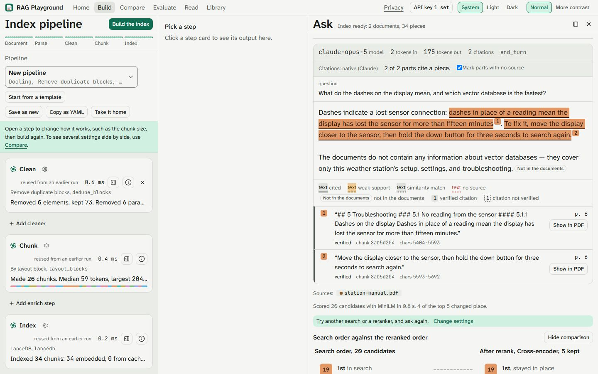
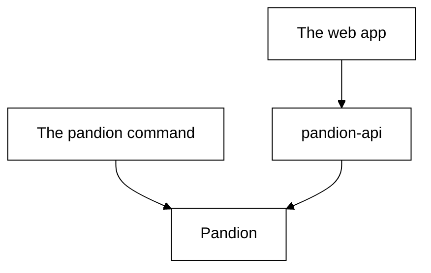

# RAG Playground

See why a RAG pipeline finds the answer, or misses it.

[Live demo](https://rag.codewithnk.com) | [Docs](docs/index.md) | [Pandion](docs/pandion/index.md) | [GitHub](https://github.com/nadeem4/rag-playground) | [Changelog](CHANGELOG.md)



RAG Playground is three parts:

- **The web app** runs a retrieval-augmented generation (RAG) pipeline on a PDF and shows
  you every step: what the parser read, what the cleaners removed, where each chunk was
  cut, what the search found and how the reranker moved it. Change one setting and see
  what it does. It has Build, Ask, Compare, Evaluate and a Library.
- **Pandion** is the Python package that runs every one of those steps. You can use it in
  your own code to build, search and question an index.
- **pandion-api** is Pandion over HTTP, with one `Policy` object for a site's rules. The
  app's server is built on it.



## Try it online

Open the [live demo](https://rag.codewithnk.com). There is no sign in. Pick a bundled
sample or upload your own file. Everything works without a key except chat answers, the
LLM reranker and the LLM rewrite. For those, add your own key with the key button at the
top right.

The demo is shared, so it has limits: [Deploy](docs/operations/deploy.md#demo-mode) lists
them. What is kept, where and for how long is on the [privacy page](docs/privacy.md).

## Run the app on your machine

You need [uv](https://docs.astral.sh/uv/) and Node.js 22 or newer.

```bash
uv sync --extra dev
cd playground/frontend && npm install && npm run build && cd ../..
uv run rag-playground
```

The server starts on http://127.0.0.1:8000. [Deploy](docs/operations/deploy.md) covers
Docker, demo mode, hardware and running your own copy on Hugging Face.
[Configuration](docs/operations/configuration.md) lists every setting.

## Use Pandion in your own code

```bash
pip install "pandion[pdfium,lancedb,local]"
```

```python
from pandion import Pipeline

p = Pipeline(path="./my-index", parse="pdfium", store="lancedb", search="hybrid_rrf", answer="search")
p.index.run("report.pdf")
print(p.ask("What does the report recommend?").text)
```

The [Pandion guide](docs/pandion/index.md) covers every step, setting and error.
[examples/](examples) has tested scripts, and the `pandion` command runs the same
pipeline from a shell.

## Serve a pipeline over HTTP

pandion-api goes to PyPI from its own tag (see the [release runbook](docs/operations/release.md#publishing-pandion-api));
until then, install it from this repository with `uv sync --extra dev`. A file `serve.py` with `create_app(ApiSettings(data_dir=...))` runs
with `uv run uvicorn serve:app`. The [pandion-api reference](docs/pandion-api/index.md#run-it)
shows the file, and the [serve mode page](docs/pandion-api/serve-mode.md) covers running
it for your site's users.

## Learn more

- [Docs index](docs/index.md): every page, grouped by who reads it.
- [The playground app](playground/README.md): how its server and web app fit together.
- [Architecture](docs/architecture.md) and [Lessons learned](docs/lessons-learned.md).
- [Contributing](CONTRIBUTING.md), [Security](SECURITY.md) and
  [Code of conduct](CODE_OF_CONDUCT.md).
- Package readmes: [Pandion](packages/pandion/README.md) and
  [pandion-api](packages/pandion-api/README.md).

## License

MIT. See [LICENSE](LICENSE).
