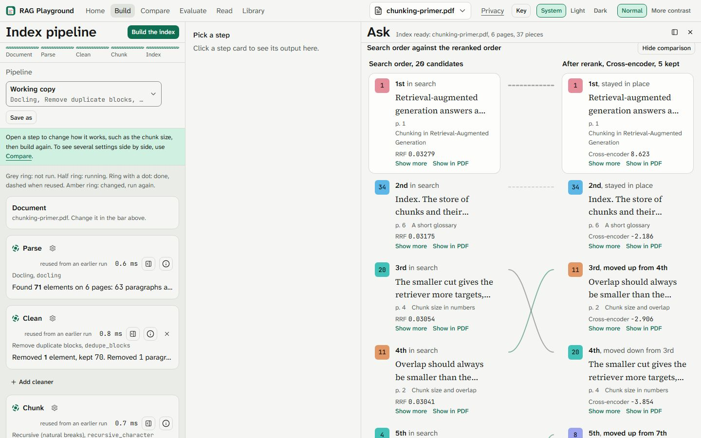
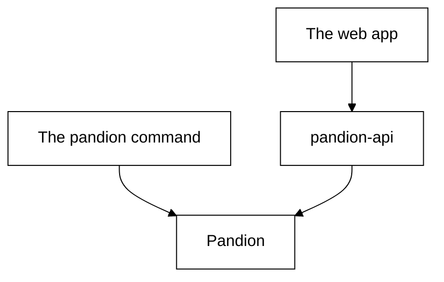

# RAG Playground

See why a RAG pipeline finds the answer, or misses it.

[Live demo](https://rag.codewithnk.com) | [Docs](https://github.com/nadeem4/rag-playground/tree/main/docs) | [Pandion](docs/pandion.md) | [GitHub](https://github.com/nadeem4/rag-playground)



RAG Playground is two things:

- **A web app** that runs a retrieval-augmented generation (RAG) pipeline on a PDF and
  shows you every step: what the parser read, what the cleaners removed, where each chunk
  was cut, what the search found and how the reranker moved it. Change one setting and
  see what it does.
- **Pandion**, the Python package that runs every one of those steps. The app is built on
  it, and you can use it in your own code to build, search and question an index.

There are four ways in: [try it online](#try-it-online),
[run your own copy on Hugging Face](#run-your-own-copy-on-hugging-face),
[run it on your machine](#run-it-on-your-machine), or
[use Pandion in your own code](#use-pandion-in-your-own-code).

## What you can do in the app

- **Build.** Run the index pipeline one card at a time: Document, Parse, Clean, Chunk and
  Index. The Document bar at the top of Build, Compare and Evaluate picks the PDF, and the Ask panel docked
  beside the cards asks a question of the index you just built.
- **Ask.** Search with dense, keyword or hybrid retrieval, rewrite the question first if
  you like, and rerank the results. A slope shows how the reranker moved each piece. Chat
  writes an answer with checked citations.
- **Compare.** Run up to ten recipes of one step and read them side by side, or in an
  overview table when there are four or more. Save an experiment to open later, and put a
  winning recipe on Build with Use on Build.
- **Evaluate.** Score a pipeline against the sample's question set, or upload your own.
  Every miss says why it missed, with the sentence that answers the question and the
  pieces that came back instead.
- **Library.** Keep saved pipelines and experiments in one list, export them to a file
  (with the document, if you like) and import them in any browser.

## Try it online

Open the [live demo](https://rag.codewithnk.com). There is no sign in.

- Pick one of the bundled samples, or upload your own PDF. On the demo an upload can be
  up to 10 MB and 20 pages, a browser can keep 3 uploads at a time, and each upload is
  deleted 24 hours after it was made. Your uploads are private to your browser.
- The demo is shared, so one browser can have two runs going at once, an evaluation
  scores at most 50 questions, and a comparison at most 120 recipe-questions (recipes
  times questions). Run the playground locally for more.
- Everything works without a key except chat answers, the LLM reranker and the LLM
  rewrite. For those, add your own Anthropic, OpenAI or OpenRouter key with the key button
  at the top right. The key stays in that browser tab's memory.

The [privacy page](https://rag.codewithnk.com/privacy) in the app says what
is kept, where and for how long. [docs/privacy.md](docs/privacy.md) says the same.

## Run your own copy on Hugging Face

1. Open the [Space](https://huggingface.co/spaces/nadeem4nk/rag-playground) and choose
   **Duplicate this Space**.
2. In the copy's settings, set the variable `RAG_PLAYGROUND_DEMO` to `0` to lift the
   demo's limits, or leave it at `1`. With demo mode off:
   - uploads have no size, page or count limit, and nothing deletes them on a timer;
   - uploads are no longer private to one browser: every visitor sees every upload;
   - server keys from the Space's secrets are used;
   - custom OpenAI-compatible endpoints are allowed;
   - question sets you upload are kept beside their document;
   - the Dev menu shows in the header.
3. Optionally add `ANTHROPIC_API_KEY`, `OPENAI_API_KEY` or `OPENROUTER_API_KEY` as
   secrets. Server keys are used only with demo mode off. With demo mode on, only a key a
   visitor types into the app is used.

The free CPU Space works; Docling parsing is slow on it. With demo mode off the copy has
no sign in, so anyone with its address can use your keys: make the Space private if you
add them. See [docs/deploy.md](docs/deploy.md) for hardware, storage and updates.

## Run it on your machine

You need [uv](https://docs.astral.sh/uv/) (it fetches Python 3.13 if you do not have it),
Node.js 22 or newer to build the web app once, and about 2 GB of disk for the models,
which download the first time they are used.

```bash
git clone https://github.com/nadeem4/rag-playground.git && cd rag-playground
cd web && npm install && npm run build && cd ..
uv run rag-playground
```

The server starts on http://127.0.0.1:8000 and opens your browser.

Or run it with Docker, from the cloned folder:

```bash
docker build -t rag-playground .
docker run --rm -p 127.0.0.1:8000:8000 -v rag-playground-data:/data rag-playground
```

Then open http://localhost:8000. The volume keeps your uploads, cached results and models.

Nothing expires locally; your files stay on your machine. You can upload larger PDFs,
use server keys from your environment or a `.env` file, and point chat at a local model
server such as Ollama. See [docs/deploy.md](docs/deploy.md) for the details.

## Use Pandion in your own code

Pandion is the engine of the playground: every step the app shows is a Pandion step. Run
one step on its own, or build a whole pipeline from a YAML file, from settings by step
name, or from classes, then index, search and ask. Every step tells you what it did, and
each result is cached, so the same files with the same settings are never processed twice.

It is [on PyPI](https://pypi.org/project/pandion/) and needs Python 3.13:

```bash
pip install "pandion[pdfium,lancedb,local]"
```

```python
from pandion import Pipeline

p = Pipeline(
    path="./my-index",
    parse="pdfium",
    chunk={"use": "recursive_character", "chunk_size": 400, "chunk_overlap": 40},
    embed="bge-small-en-v1.5",
    store="lancedb",
    search="hybrid_rrf",
    answer="search",
)
p.index.run("report.pdf")
print(p.ask("What does the report recommend?").text)
```

The [Pandion guide](docs/pandion.md) covers every step, setting and error, and
[examples/pandion/](examples/pandion) has scripts that index, sync, search and ask.
To write your own strategy for any step, start from
[examples/pandion/own_strategies/](examples/pandion/own_strategies): it writes one for
every stage (source, parse, clean, chunk, store, rewrite, search, rerank and
answer), plus an embedder, and runs with no download. See
[Write your own strategy](docs/pandion.md#write-your-own-strategy).
Evaluate a pipeline on your own questions, and compare settings at one stage: see
[Evaluate a pipeline](docs/pandion.md#evaluate-a-pipeline) and
[Compare settings](docs/pandion.md#compare-settings).

### Use Pandion from the command line

`pandion validate pipeline.yaml`, `pandion index pipeline.yaml report.pdf`, `pandion ask pipeline.yaml "..."`:
the same pipeline, from the command line. `--plugins my_strategies` loads your own
strategies first. See [the pandion command](docs/pandion.md#the-pandion-command).

### How the pieces fit



The `pandion` command uses Pandion. The web app uses pandion-api, Pandion's REST layer.
pandion-api uses Pandion.

## What's inside

Each step offers these strategies. The plain name is what the app shows; the code name is
the strategy's id in the API and in exported files.

| Step | Strategies you can pick |
|---|---|
| Document | A bundled sample, or Upload (`upload`) |
| Parse | Fast text (`pdfium`), Docling (`docling`) |
| Clean | Remove headers and footers (`header_footer_strip`), Remove duplicate blocks (`dedupe_blocks`), Remove matching text (`drop_matching`) |
| Chunk | Recursive, natural breaks (`recursive_character`), By heading (`markdown_header`), Fixed token count (`token_based`), By layout block (`layout_blocks`), By sentence (`sentence_window`) |
| Index | LanceDB (`lancedb`), with the Qwen3 or bge-small embedder |
| Query rewrite | None, PRF (`hybrid_rrf` with `query_expansion: prf`), LLM rewrite (`llm_rewrite`) |
| Search | Dense (`dense`), BM25 (`bm25`), Hybrid, RRF (`hybrid_rrf`) |
| Rerank | None, Cross-encoder (`cross_encoder`), MMR (`mmr`), LLM (`llm_rerank`) |
| Answer | Search (`search`), Chat with a model (`chat`), and Evaluate's check (`eval`) |

[docs/strategies.md](docs/strategies.md) explains each one and its settings.

Every pipeline you build can be copied as a Pandion YAML file and run outside the playground.

The server is [pandion-api](docs/pandion-api.md), Pandion's REST layer, with the playground's own rules for the hosted demo.
Its code is in `playground/backend/`; [playground/README.md](playground/README.md) explains how the app is put together.
The browser keeps your pipeline as a Pandion config: one working copy on Build, and named
copies in the Library. [Architecture](docs/architecture.md#how-the-web-app-holds-a-pipeline)
explains how.

## Learn more

- [Guide](docs/guide.md): every page of the app in detail.
- [Strategies](docs/strategies.md): every step and setting, and when to use each.
- [Models and keys](docs/models-and-keys.md): the models the app downloads, the chat
  providers, and what happens to a key.
- [Privacy](docs/privacy.md): what is kept in your browser and on the demo server, and
  for how long.
- [Deploy](docs/deploy.md): Docker, demo mode, variables, and running your own Space.
- [Pandion](docs/pandion.md): the package. Run a step on its own, or build a pipeline in a
  file or in code, then index, search and ask.
- [pandion-api](docs/pandion-api.md): Pandion over HTTP, with one Policy object for a site's rules. The playground's server is built on it.
- [The playground app](playground/README.md): how its server and its web app fit together.
- [Architecture](docs/architecture.md): the three layers, the pipeline and its stages,
  plugins, the cache, the run stream and how the browser holds a pipeline.
- [Lessons learned](docs/lessons-learned.md): real problems we hit building the pipeline,
  why each happened, what fixed it and what we learned.
- [Contributing](CONTRIBUTING.md): development setup, tests, adding a strategy and
  cutting a release.

## License

MIT. See [LICENSE](LICENSE).
