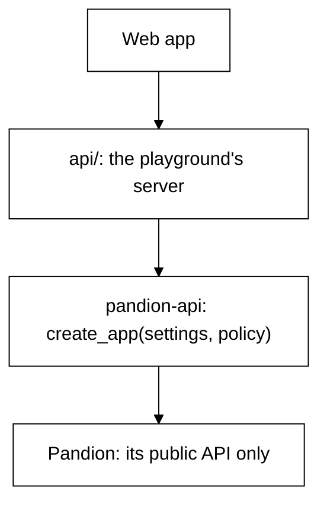
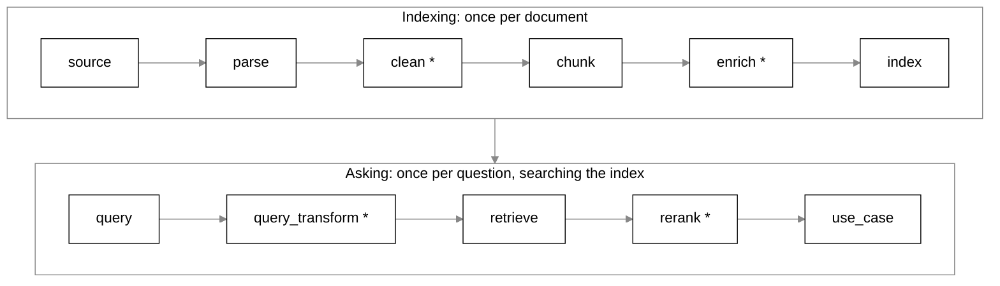

# Architecture

How RAG Playground is put together: a FastAPI server that runs pipeline graphs, plugins
for every strategy, a content-addressed cache, a stream of run events, and a React app
that talks to the API.

## Contents

- [The layout of the repo](#the-layout-of-the-repo)
- [Using the package on its own](#using-the-package-on-its-own)
- [The REST layer: pandion-api](#the-rest-layer-pandion-api)
- [The pipeline graph and its stages](#the-pipeline-graph-and-its-stages)
- [Plugins](#plugins)
- [Artifacts and the cache](#artifacts-and-the-cache)
- [The run stream](#the-run-stream)
- [How the web app talks to the API](#how-the-web-app-talks-to-the-api)
- [How the web app holds a pipeline](#how-the-web-app-holds-a-pipeline)

## The layout of the repo

```
packages/pandion/  the engine as its own Python package, pandion: artifacts, transforms, the
                   graph, the executor, the content-addressed store, the embedding models
                   and their cache, the chat model client, and the pipeline file
packages/pandion-api/  pandion-api: Pandion's public API over HTTP, with a Policy for a site's rules
api/         the playground's server: pandion-api with the playground's Policy (api/policy.py),
             the old /api routes until part 5, the teaching routes (samples, lessons, stage
             copy), demo mode, and the web build; the manifest of the steps it loads is in
             api/steps/
web/         the React app: Home, Build, Compare, Evaluate, Library, Read, inspectors
samples/     the bundled sample PDFs, each with its question set
scripts/     generate the samples, record the Home clips, publish the Space
tests/       pytest: unit, plugin contract, API and integration tests
```

The app depends on `pandion` through a uv workspace, so `uv sync` installs it from
`packages/pandion/` and an edit there is live at once. The engine is moving into the
package one stage at a time. The upload step (`pandion/plugins/source/`), the parsers
(`pandion/plugins/parse/`), the cleaners (`pandion/plugins/clean/`), the chunkers
(`pandion/plugins/chunk/`), the lancedb index (`pandion/plugins/index/`), the query
steps, `text` and `llm_rewrite` (`pandion/plugins/query/`), the retrievers, `dense`,
`bm25` and `hybrid_rrf` (`pandion/plugins/retrieve/`), and the rerankers, `mmr`,
`cross_encoder` and `llm_rerank` (`pandion/plugins/rerank/`), and the answer steps,
`search` and `chat` with its sentence-id grounding (`pandion/plugins/answer/`, still
registered under the `use_case` stage), have moved,
with the token counter the chunkers use (`pandion/tokenize.py`), the sentence splitter
(`pandion/text.py`, which the chat grounding also uses), the embedding models
(`pandion/embeddings.py`), the embedding cache (`pandion/embedding_cache.py`) and the
model settings (`pandion/models.py`), the chat model client (`pandion/llm.py`) and the
custom endpoint check (`pandion/endpoints.py`). The `eval` step, which the Evaluate page runs, moved too
(`pandion/plugins/answer/eval.py`, under the `use_case` stage but refused as an answer step), so the app has no steps of its own. Reading and checking question sets (`pandion/questions.py`) and the miss trace (`pandion/trace.py`) moved with it, public as `pandion.evaluation`. A moved strategy's library is an extra of the package (`pandion[pdfium]`,
`pandion[docling]`, `pandion[lancedb]`, `pandion[local]` for the local models, and
`pandion[openai]` and `pandion[anthropic]` for the chat models), imported only when the
step runs, and the app installs the extras it uses. The cleaners and the chunkers need only the standard library and Pydantic, so they
come with the base install. A moved stage can also run on its own, with no pipeline and
no cache: `pandion.parse` parses one file, `pandion.clean` runs a list of cleaning steps
on one document, in the order given, and `pandion.chunk` cuts one document into pieces
with one chunker, and `pandion.rewrite` turns one question into the query retrieval
searches with. `Pipeline.from_yaml("pipeline.yaml").index.run("docs/")` builds a whole
index from a config file, through the executor and a store, so it caches every step.
A pipeline has three parts, `IndexPipeline`, `RetrievalPipeline` and `QueryPipeline`,
and can be written three ways: a YAML file, a dict per stage, or step classes such as
`pandion.parse.Docling` (each the transform's own config model with its name added, made
by `pandion.config.step_class`). Every way goes through `pandion.config.from_dict`, so
the same settings give the same graph and the same artifact ids, and `to_yaml()` writes
any of them back as a file. `pandion.parse`, `clean`, `chunk` and `rewrite` are modules
that hold their stage's classes and still run one stage when called.
`index.sync("docs/")` keeps that index in step with a folder: it records each document's
content hash and pieces in `manifest.json` under the config's `path` (`pandion/manifest.py`),
builds the index again from cached steps, reports what was added, changed, removed and
unchanged, and deletes the previous index from the store. The app does not use sync.
`p.retrieve(question, k=5)` searches that index with the file's `retrieve` section
(rewrite, search, rerank) in one graph with the index steps, so the index is a cache hit,
and returns the hits with every step's `StageResult`. `p.ask(question)` adds the file's
`answer` step, `search` or `chat`, to that graph and returns an `Answer` with the
answer step's output and every step's `StageResult`. The app uses neither. The
app runs the same strategies through its pipeline graph, and
`tests/integration/test_app_uses_pandion_chunkers.py`,
`tests/integration/test_app_uses_pandion_index.py`,
`tests/integration/test_app_uses_pandion_query.py`,
`tests/integration/test_app_uses_pandion_retrievers.py`,
`tests/integration/test_app_uses_pandion_rerankers.py`,
`tests/integration/test_app_uses_pandion_answer.py` and
`tests/integration/test_app_uses_pandion_evaluation.py` check both give the same pieces,
the same index, the same query, the same hits, before and after a reranker, the same
answer, and the same eval verdict. `pandion.evaluate(p, questions)` asks every question
and scores it with the same `eval` step; the app's Evaluate page still runs that step
through `POST /api/sweeps` and adds up the scores in the browser.
`pandion.compare(p, stage, variants, documents, questions)` builds one pipeline per
variant and evaluates each; the app's Compare page still uses `POST /api/sweeps`, which
runs `pandion.executor.sweep`. The `mmr` reranker and the `chat` step embed with the
index's own model through two public names of `pandion.plugins.retrieve`,
`read_descriptor` and `embedder_for`.

The package takes every folder as an argument. A run is handed the sources folder, the
embedding cache and the model settings in `context_extras`, which are never hashed. The
app builds them once in `api/deps.py` from its environment variables
(`RAG_PLAYGROUND_SOURCES`, `RAG_PLAYGROUND_ARTIFACTS`, `RAG_PLAYGROUND_EMBED_CACHE`) and
passes them to every run as `Deps.run_extras()`. It loads models on the CPU, and the
warm-up loads the default embedder and cross-encoder with the public
`pandion.preload_embedder` and `pandion.preload_reranker`.

The package never reads the demo switch either. A step that calls a chat model takes
`public_endpoints_only` from the run (and `pandion.llm` takes `public_only=`): when it is
on, a custom endpoint must be a public https address, its client follows no redirects,
and no message suggests setting a key on the server. `Deps.run_extras()` turns it on
when `RAG_PLAYGROUND_DEMO` is `1`, read by `api.demo.public_endpoints_only()`. The package's
`llm_rewrite`, `llm_rerank` and `chat` take it from the run. That check is the second line: the run routes still
refuse a custom endpoint on the demo with a 403 first, and the second line reads the
switch on its own, so it holds even if the first is lifted. API keys reach a run only as
`context_extras["credentials"]`, never in a config or a hash.
The prompts of `llm_rewrite`, `llm_rerank` and `chat` are settings marked `readOnly` in
their schema. `GET /api/registry` leaves them out of the forms, and the run routes
(`POST /api/runs` and each variant of `POST /api/sweeps`) refuse with a 403 a run that sets
one to anything but its default, in every mode. Both read the marker through
`read_only_settings` in `api/routes/registry.py`. A pipeline file or code can set them.
The app imports Pandion through its public API: `pandion`, the stage namespaces
(`pandion.parse` to `pandion.answer`) and `pandion.extend`, each a name in the module's
`__all__`. It never imports a private name (one starting with an underscore), and the
package never imports the app. The engine names the app still imports from Pandion's
inner modules (`pandion.graph`, `pandion.executor`, `pandion.storage` and the rest) are
listed in `ENGINE_IMPORTS` in `tests/integration/test_package_boundary.py`. That list may
only shrink: a new engine import fails the test, and so does a line the app no longer
needs. `packages/pandion/tests/test_boundaries.py` checks the package never imports the app.

## Using the package on its own

See the [pandion guide](pandion.md).

## The REST layer: pandion-api



`packages/pandion-api` serves Pandion over HTTP. It imports only Pandion's public API,
which `packages/pandion-api/tests/test_api_boundary.py` checks with no allow-list, and it
takes a pipeline as the pipeline file's shape. A site's rules are one `Policy` object. A
request's pipeline always runs with the server's folder and models, and a request cannot
name plugins to import (`pandion_api.pipelines.prepare`). The playground's Policy refuses
on `/api/v2` what its old routes refuse: a custom model endpoint on the demo and a changed
prompt or model revision everywhere. It also caps a model step's output at 16,000 tokens
and each text budget at four times its default. See [pandion-api](pandion-api.md).

## The pipeline graph and its stages

The engine has two ideas and no `Pipeline` class:

- **Artifact.** An immutable result, such as a parsed document, a chunk set, an index or a
  set of retrieval hits.
- **Transform.** A strategy that turns typed input artifacts into one output artifact.

A pipeline is a graph of transforms. Each node is one transform in one stage, with its
config, and each edge joins an output to an input port of the right type. The graph is
validated before it runs: an invalid graph is a 400 and an invalid node config a 422.



`*` marks a stackable stage: its input and output have the same type, so it can be added
several times, for example two cleaners in a row.

| Stage | What it is for | Strategies |
|---|---|---|
| `source` | The document you work on | `upload` |
| `query` | The question, and optionally the sentences that answer it | `text`, `llm_rewrite` |
| `parse` | Turns the PDF into text elements with their pages and positions | `pdfium`, `docling` |
| `clean` | Removes text that would pollute retrieval | `header_footer_strip`, `dedupe_blocks`, `drop_matching` |
| `chunk` | Cuts the text into the pieces that get indexed | `recursive_character`, `markdown_header`, `token_based`, `layout_blocks`, `sentence_window` |
| `enrich` | Adds context to chunks before indexing | none yet |
| `index` | Embeds the chunks and stores them for vector and keyword search | `lancedb` |
| `query_transform` | Rewrites the question before retrieval | none yet; the LLM rewrite is a `query` strategy |
| `retrieve` | Finds the candidates for the question | `dense`, `bm25`, `hybrid_rrf` |
| `rerank` | Picks the best few candidates | `mmr`, `cross_encoder`, `llm_rerank` |
| `use_case` | What you finally get | `search`, `chat`, `eval` |

[strategies.md](strategies.md) describes each strategy.

## Plugins

A strategy is one Python module under `packages/pandion/src/pandion/plugins/<stage>/`. It defines a Pydantic config
model and a `Transform` subclass registered with `@register`. The class declares its
stage, its input ports, its output type, a `summary`, and an `explain(config)` that says
what these settings will do.

- `api/steps/__init__.py` lists every module the app loads in `PLUGIN_MODULES`, all of them in the package. A test fails if a plugin
  module exists but is not listed.
- `GET /api/registry` exports every transform with its summary, its config's JSON schema,
  and what it requires, provides and prefers. The web app builds every settings form from
  that schema, so a new strategy needs no frontend change.
- **Requires** is a hard lock: a retriever that needs a keyword index cannot run on an
  index built without one, the graph is rejected, and the app greys the option out.
- **Prefers** is a soft lock: the strategy still runs but falls back, with a sentence
  saying what happens instead, and the app tags it "Falls back".

[CONTRIBUTING.md](../CONTRIBUTING.md#adding-a-strategy) walks through adding one.

## Artifacts and the cache

An artifact's id is a hash of its recipe: the transform, the transform's version, its
fingerprint (such as the model it used), its config and the ids of its inputs, keyed by
input port. The id is known before the transform runs, so a node whose artifact is already
in the store is not run again.

That is what makes changing one setting cheap. Sweeping three chunkers over one parse is
one cached parse and three new chunk sets.

- **The store** (`pandion/storage.py`) keeps each artifact in its own folder under the
  artifacts folder. A write goes to a temp folder and is moved into place, and its
  `meta.json` is written last, so a crash never leaves an entry that looks finished.
  Nothing expires an entry; `DELETE /api/cache` clears the store. Only the package's
  sync deletes one entry, the index a sync has replaced.
- **The embedding cache** (`pandion/embedding_cache.py`) keeps embeddings in SQLite at
  full width, keyed by model, revision, dtype, kind and text, so the same piece is
  embedded once. The app keeps it in `.embcache` under the artifacts folder.
- **Uploads** are stored once under the sources folder, named by a fingerprint of their
  bytes (`pandion/sources.py`).

## The run stream

The executor (`pandion/executor.py`) walks a validated graph, skips any node whose artifact
is cached, and emits an event for each step. A failure is data, not an exception: a
failed node is recorded with its traceback, the nodes below it are skipped, and unrelated
branches keep running.

A run is two requests:

1. `POST /api/runs` with the graph validates it, resolves the API keys from the request
   headers, starts the run in a worker thread and answers 202 with the run's id.
2. `GET /api/runs/{run_id}/events` streams the run's events as server-sent events:
   `run_started`, `node_started`, `node_skipped`, `node_failed`, `run_finished` or
   `run_cancelled`, then `stream_end`. A client that reconnects passes the last event id
   and gets the rest from there.

Build no longer uses this route: a card's Run starts with `POST /api/v2/runs` and Ask with
`POST /api/v2/ask`, which take the pipeline as a config and answer 202 with a run id in the
same way. The events stream from `GET /api/v2/runs/{run_id}/events`.

Compare uses `POST /api/sweeps` in the same way: one node, up to ten variants, with
`variant_started` and `variant_finished` events. `POST /api/runs/{run_id}/cancel` stops a
run.

The run manager is `pandion_api.runs.RunManager`, one per app. The playground's old routes
and pandion-api's routes use the same one, so the demo's limit on runs at once holds
across both. A run is stopped through its `cancel`, a `threading.Event` that Pandion takes
as it is.

The keys live only in the run's worker for its duration, and every event passes through a
filter that replaces a key with `[redacted]` (`pandion_api.credentials.redact`, one for
both stacks). On `/api/v2` an index run is `POST /api/v2/runs` with a pipeline and
document ids; its result gives each step's result id. On the demo a run started there is
its visitor's own: to anyone else it is a 404 on both stacks.

The web follows every run on `/api/v2/runs/{id}/events`, whichever route started it,
because both stacks share one run manager. A `/api/v2` event names its step (`parse`,
`clean.1`, `search`, `answer`) and, for a document's step, the document; the web draws it
on the card of the same name (`clean_1`, `retrieve`, `use_case`). A comparison's events
carry `variant`, an evaluation's `question`, with a `question_finished` after each. When
the stream ends, the web reads the run's `result` from `GET /api/v2/runs/{id}`. Stop calls
`POST /api/v2/runs/{id}/cancel`, which answers 409 once the run has finished. Runs still
start on the old routes until the later part 5 tasks move each page.

## How the web app talks to the API

The web app is React, built with Vite into `web/dist`. FastAPI serves it, with a fallback
so every client route opens the app, and every API route lives under `/api`. The app uses
relative paths, so the same code works in development, where Vite on port 5173 proxies
`/api` to the server on port 8000.

The server answers on two prefixes until part 5. `/api` holds the routes the web uses
today. `/api/v2` holds pandion-api's routes with the playground's Policy, which take a
pipeline as the pipeline file's shape. Both share one run queue, one record lock and one
pdfium lock (`pandion_api.pages.PDFIUM_LOCK`: pdfium is not thread-safe), and every site
rule has one implementation. `tests/api/test_v2_parity.py` runs today's tests a second time against
`/api/v2` to prove the rules hold there, and fails if a rule test neither runs there nor
says why.

Part 5 moves the web onto `/api/v2`: it keeps a pipeline as the pipeline file's shape
instead of a graph, runs one card with `POST /api/v2/runs` and `through`, asks with
`POST /api/v2/ask`, and evaluates and compares with `POST /api/v2/evaluations` and
`/comparisons`. Then the old routes and their tests go. The allow-list in
`tests/integration/test_package_boundary.py` cannot simply go with them: other playground
parts still use engine internals and need porting to the public API or removing first.
They are `api/routes/learn.py`, `api/warmup.py`, `api/deps.py`, `POST /api/sources/sample`
and the recording scripts `scripts/record_*.py`. Runs also do not hold the pdfium lock
today: a run's pdfium parse step can meet a page request on another thread. What part 5
must still decide is listed in [pandion-api](pandion-api.md#what-part-5-must-decide).

- **Registry.** The app reads `GET /api/registry` to build the step cards and their forms.
- **Runs.** A card's Run sends the pipeline as a config with `through` set to the card's
  step, to `POST /api/v2/runs`; Build the index is the Index card's Run. Ask sends the
  config, its documents and the question to `POST /api/v2/ask`, with `answer: false` when
  it stops after the search. The app opens an `EventSource` on
  `/api/v2/runs/{id}/events`, one per run; Stop posts to `/api/v2/runs/{id}/cancel`. The
  `/api/v2` client is `web/src/api/v2.ts`; it sends keys in the same headers as `/api`.
- **Artifacts.** The inspectors read results with `GET /api/artifacts/{id}/payload`.
- **Miss trace.** Evaluate posts a question's answer sentences and the artifacts its run
  made to `POST /api/trace`, which says the first step that lost the answer, with the
  eval step's own matching, through `pandion.evaluation.trace`.
- **Sources.** Uploads, page images and the PDF itself come from `/api/sources`.
- **Settings.** `GET /api/settings/app` says whether demo mode is on and gives its limits.
- **Keys.** A key typed in the app is sent as a header on runs, sweeps and key checks.
- **State.** Saved pipelines, experiments and the working pipeline live in the browser's
  storage; see [privacy.md](privacy.md).
- **Pipelines and documents.** A saved pipeline is a name, a graph and a list of documents
  (`web/src/state/pipelines.ts`). The graph's source node points at the first document, so
  the run request, recipe hashes and cache keys are what they were. Pipelines stored, shared
  or exported before the list existed get it on read, from the source node; share links are
  version 2 and still read version 1. The ready-made Starter pipeline
  (`web/src/state/starter.ts`) is the default recipe `sampleGraph` builds, on the default
  sample, and is never stored as a saved pipeline. `web/src/state/pipelineChoice.ts` lists
  what Evaluate can score and picks the one it opens on. A question in a question set may
  name its `document`; the server fills in the set's one document and refuses a set that
  names two, so scoring several documents later needs no new file format.
- **Documents on the page.** One element names a document everywhere
  (`web/src/components/DocumentItem.tsx`): full, with page 1's picture, the title, the file
  name, the page count and Sample or Your upload, or compact, with the picture and the
  title. Its Preview (`DocumentPreview.tsx`) opens the shared side sheet
  (`web/src/components/SideSheet.tsx`) on every page, from the same page sizes and page
  images the PDF viewer uses (`GET /api/sources/{sha}/pages` and
  `/api/sources/{sha}/pages/{n}.png`). The Document control (`DocumentControl.tsx`) is the
  link beside it that changes the document: in Build's Document step, under Evaluate's
  Documents and on Compare's Document line. The header has none.

The app also has lessons, a guided walk through each step, but they are switched off
(`LESSONS_ENABLED` in `web/src/state/lessons.ts`) while they are reworked.

## How the web app holds a pipeline

The browser holds a pipeline as the pipeline file's shape (`PipelineConfig` in
`web/src/state/config.ts`), with the documents it runs on and the question Ask asks beside
it, never `path`, `models` or `plugins`. Pipelines saved by older versions held a graph of
steps; `graphToConfig` converts each one once, and one it cannot convert is kept with the
reason and never deleted. Build draws its column from the config (`columnOf`); each card's
id maps to the step name runs report (`clean_2` is `clean.2`, `retrieve` is `search`).

Build's working pipeline is kept this way (`web/src/state/working.ts`), in localStorage
under `rag-playground:pipeline:v2`, so Build, Compare and Evaluate share it. `graph.ts`
keeps the names every page already used (`useStoredGraph`, `storeGraph`): they draw the
column from the stored config and store a column as a config. A column that is not one
(no Parse step, say) is not stored. Versions before this one kept a graph under
`rag-playground:graph:v1`. The first time nothing is stored under the new key, that graph
is converted once. If it cannot be, the reason is written under
`rag-playground:graph:v1:kept`, Build opens on the Starter and says why once, and the old
graph is never tried again. The old key is never written or removed, so the old pipeline is
kept either way. A stored pipeline that uses a strategy this server does not have cannot be
drawn, and every page would store a Starter in its place. Before that, it is copied as it was
to `rag-playground:pipeline:v2:kept` with the reason, beside any kept before, and Build says
why once. Build's per-tab results moved to `rag-playground:build-session:v2`,
because the old ones were keyed by the old graph's card ids.

Saved pipelines, share links and export files still hold a graph; they move to the config
in later changes. The fixture
`web/src/api/fixtures/starter.config.json` is `samples/starter.yaml` as the browser holds
it, and two tests pin that converting the app's Starter gives that file, so a visitor's
Starter keeps its result ids.
