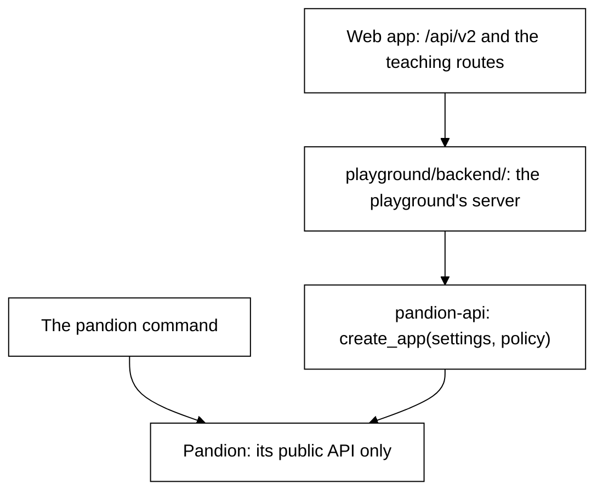
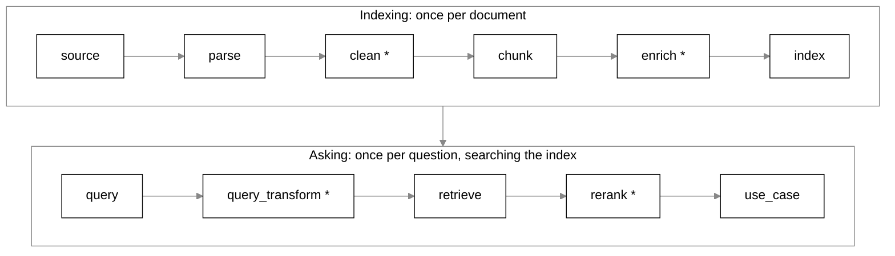
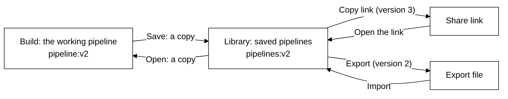

# Architecture

How RAG Playground is put together, in three layers. Pandion, the engine, runs a pipeline
written as a config, with a plugin for every strategy, a content-addressed cache and a
stream of run events. pandion-api serves Pandion over HTTP. The `pandion` command uses
Pandion directly, and the React web app talks only to pandion-api.

## Contents

- [The layout of the repo](#the-layout-of-the-repo)
- [Using the package on its own](#using-the-package-on-its-own)
- [The three layers](#the-three-layers)
- [The pipeline and its stages](#the-pipeline-and-its-stages)
- [Plugins](#plugins)
- [Artifacts and the cache](#artifacts-and-the-cache)
- [The run stream](#the-run-stream)
- [How the web app talks to the API](#how-the-web-app-talks-to-the-api)
- [How the web app holds a pipeline](#how-the-web-app-holds-a-pipeline)

## The layout of the repo

```
packages/pandion/  the engine as its own Python package, pandion: artifacts, transforms, the
                   graph, the executor, the content-addressed store, the embedding models
                   and their cache, the chat model client, and the pipeline file
packages/pandion-api/  pandion-api: Pandion's public API over HTTP, with a Policy for a site's rules
playground/backend/  the playground's server: pandion-api with the playground's Policy
             (playground/backend/policy.py) under /api/v2, the teaching routes under /api
             (playground/backend/routes/: health, samples, lessons, stage copy, app settings,
             the question template, the pipeline templates from Pandion), demo mode, and
             the web build. It has no steps of its own: Pandion loads its plugins itself.
             See playground/README.md
playground/frontend/  the React app: Home, Build, Compare, Evaluate, Library, Read,
             inspectors. See playground/frontend/README.md
samples/     the bundled sample PDFs, each with its question set
scripts/     generate the samples, record the Home clips, publish the Space
tests/       pytest: unit, plugin contract, API and integration tests
```

The app depends on `pandion` through a uv workspace, so `uv sync` installs it from
`packages/pandion/` and an edit there is live at once. Every step lives in the package.
The upload step (`pandion/plugins/source/`), the parsers
(`pandion/plugins/parse/`), the cleaners (`pandion/plugins/clean/`), the chunkers
(`pandion/plugins/chunk/`), the lancedb index (`pandion/plugins/index/`), the query
steps, `text` and `llm_rewrite` (`pandion/plugins/query/`), the retrievers, `dense`,
`bm25` and `hybrid_rrf` (`pandion/plugins/retrieve/`), and the rerankers, `mmr`,
`cross_encoder` and `llm_rerank` (`pandion/plugins/rerank/`), and the answer steps,
`search` and `chat` with its sentence-id grounding (`pandion/plugins/answer/`, still
registered under the `use_case` stage), have moved,
with the token counter the chunkers use (`pandion/tokenize.py`), the sentence splitter
(`pandion/text.py`, which the chat grounding also uses), the embedding models
(`pandion/embeddings.py`), the embedding cache (`pandion/embedding_cache.py`) and the
model settings (`pandion/models.py`), the chat model client (`pandion/llm.py`) and the
custom endpoint check (`pandion/endpoints.py`). The `eval` step, which the Evaluate page runs, moved too
(`pandion/plugins/answer/eval.py`, under the `use_case` stage but refused as an answer step), so the app has no steps of its own. Reading and checking question sets (`pandion/questions.py`) and the miss trace (`pandion/trace.py`) moved with it, public as `pandion.evaluation`. A moved strategy's library is an extra of the package (`pandion[pdfium]`,
`pandion[docling]`, `pandion[lancedb]`, `pandion[local]` for the local models, and
`pandion[openai]` and `pandion[anthropic]` for the chat models), imported only when the
step runs, and the app installs the extras it uses. The cleaners and the chunkers need only the standard library and Pydantic, so they
come with the base install. A moved stage can also run on its own, with no pipeline and
no cache: `pandion.parse` parses one file, `pandion.clean` runs a list of cleaning steps
on one document, in the order given, and `pandion.chunk` cuts one document into pieces
with one chunker, and `pandion.rewrite` turns one question into the query retrieval
searches with. `Pipeline.from_yaml("pipeline.yaml").index.run("docs/")` builds a whole
index from a config file, through the executor and a store, so it caches every step.
A pipeline has three parts, `IndexPipeline`, `RetrievalPipeline` and `QueryPipeline`,
and can be written three ways: a YAML file, a dict per stage, or step classes such as
`pandion.parse.Docling` (each the transform's own config model with its name added, made
by `pandion.config.step_class`). Every way goes through `pandion.config.from_dict`, so
the same settings give the same graph and the same artifact ids, and `to_yaml()` writes
any of them back as a file. `pandion.parse`, `clean`, `chunk` and `rewrite` are modules
that hold their stage's classes and still run one stage when called.
`index.sync("docs/")` keeps that index in step with a folder: it records each document's
content hash, pieces, category, reason and labels in `manifest.json` under the config's `path` (`pandion/manifest.py`),
builds the index again from cached steps (`add` and `move` do the same for one document), reports what was added, changed, removed and
unchanged, and deletes the previous index from the store. The app does not use sync.
`p.retrieve(question, k=5)` searches that index with the file's `retrieve` section
(rewrite, search, rerank) in one graph with the index steps, so the index is a cache hit,
and returns the hits with every step's `StageResult`. `p.ask(question)` adds the file's
`answer` step, `search` or `chat`, to that graph and returns an `Answer` with the
answer step's output and every step's `StageResult`. The app runs them through
pandion-api: Build's Ask is `POST /api/v2/ask`. The `tests/integration/test_app_uses_pandion_*.py`
files check that the registry holds the package's strategies and that the app's old copies
are gone, and `test_app_uses_pandion_evaluation.py` checks that `POST /api/v2/evaluations`
gives the same score as `pandion.evaluate`. `pandion.evaluate(p, questions)` asks every question
and scores it with the same `eval` step; the app's Evaluate page runs it through
`POST /api/v2/evaluations` and shows the totals it returns.
`pandion.compare(p, stage, variants, documents, questions)` builds one pipeline per
variant and evaluates each; the app's Compare page runs it through
`POST /api/v2/comparisons` and shows the best it names. The `mmr` reranker and the `chat` step embed with the
index's own model through two public names of `pandion.plugins.retrieve`,
`read_descriptor` and `embedder_for`.

The package takes every folder as an argument. The app keeps only where its files live in
`playground/backend/deps.py`: the sources and artifacts folders, from `RAG_PLAYGROUND_SOURCES` and
`RAG_PLAYGROUND_ARTIFACTS`, and the web build. pandion-api runs every pipeline under the
one folder that holds them, with the embedding cache in `embeddings/` beside them, and
loads models with the app's model settings (`APP_MODELS`, on the CPU). The warm-up loads
Docling, the default embedder, the default cross-encoder and `BAAI/bge-reranker-v2-m3`
(the cross-encoder the Best precision, Vague questions and Chat answer templates use),
each cross-encoder in its own try, with the public
`pandion.preload_parser`, `pandion.preload_embedder` and `pandion.preload_reranker`. The
lessons parse their sample with `pandion.parse` and read its text with
`pandion.evaluation.document_text`.

The package never reads the demo switch either. A step that calls a chat model takes
`public_endpoints_only` from the run (and `pandion.llm` takes `public_only=`): when it is
on, a custom endpoint must be a public https address, its client follows no redirects,
and no message suggests setting a key on the server. `PlaygroundPolicy.public_endpoints_only`
turns it on when `RAG_PLAYGROUND_DEMO` is `1`, read by `playground.backend.demo.public_endpoints_only()`. The package's
`llm_rewrite`, `llm_rerank` and `chat` take it from the run. That check is the second line:
`PlaygroundPolicy.check_run` refuses a custom endpoint on the demo with a 403 first, and the
second line reads the switch on its own, so it holds even if the first is lifted. API keys reach a run only as
`context_extras["credentials"]`, never in a config or a hash.
The prompts of `llm_rewrite`, `llm_rerank` and `chat` are settings marked `readOnly` in
their schema. `GET /api/v2/strategies` leaves them out of the forms (through
`served_catalog` in `playground/backend/routes/registry.py`), and the playground's Policy refuses with a
403 a run, an evaluation or a comparison that sets one to anything but its default, in
every mode. A pipeline file or code can set them. The browser never holds one:
`servedConfig` in `playground/frontend/src/state/config.ts` keeps only the settings a step's served schema
lists, and `columnOf` draws a config through it. So a link, an imported file, a saved
pipeline or Build's stored pipeline that carries a prompt, the revision or a setting
Pandion no longer knows opens without it, the saved copy loses it too, and the page names
what went in one sentence.
**Categories in the browser.** The browser's config reads both pipeline file shapes. An old file keeps Parse, Clean and Chunk under `index` and is held, saved and sent exactly as before; `categoriesOf` reads it as one category, `default`. A file with `categories` and `route` is held in the new shape, and `columnOf(pipeline, registry, category)` draws one category's steps. A document's category is a pin on its `DocRef` (`category`), kept in the source node's `documents` list and sent as `categories` (sha to category id) on runs, asks, evaluations and comparisons. `v2.sortDocuments` calls `POST /pipelines/sort` for the category and reason of each document.
**The package boundary.** The app imports only Pandion's public API and pandion-api;
`tests/integration/test_package_boundary.py` fails on any other Pandion import, with no
allow-list. The public API is `pandion`, the stage namespaces (`pandion.parse` to
`pandion.answer`), `pandion.extend` and `pandion.evaluation`, each a name in the module's
`__all__`. The test reads `playground/backend/`, `playground/frontend/scripts/` and `scripts/`.
`packages/pandion/tests/test_boundaries.py` checks the package never imports the app.

## Using the package on its own

See the [pandion guide](pandion.md).

## The three layers



Each layer uses only the public API of the one below. The `pandion` command uses Pandion,
the web app uses pandion-api, and pandion-api uses Pandion.

`packages/pandion-api` serves Pandion over HTTP. It imports only Pandion's public API,
which `packages/pandion-api/tests/test_api_boundary.py` checks with no allow-list, and it
takes a pipeline as the pipeline file's shape. A site's rules are one `Policy` object. A
request's pipeline always runs with the server's folder and models, and a request cannot
name plugins to import (`pandion_api.pipelines.prepare`). The playground's Policy refuses
a custom model endpoint on the demo and a changed prompt or model revision everywhere. It also caps a model step's output at 16,000 tokens
and each text budget at four times its default. See [pandion-api](pandion-api.md).

## The pipeline and its stages

A pipeline is written one way everywhere: as a config, the pipeline file's shape, in a
YAML file, in code, in a request and in the browser. Under `Pipeline`, the engine has two
ideas:

- **Artifact.** An immutable result, such as a parsed document, a chunk set, an index or a
  set of retrieval hits.
- **Transform.** A strategy that turns typed input artifacts into one output artifact.

When a pipeline runs, Pandion turns its config into a graph of transforms inside the
engine: each step is one transform, joined to the steps it reads from by named input
ports. Nobody outside the engine writes that graph. The config is checked when it is read:
a wrong step or setting is a `ConfigError` with one sentence, which pandion-api returns
as a 422.



`*` marks a stackable stage: its input and output have the same type, so it can be added
several times, for example two cleaners in a row.

| Stage | What it is for | Strategies |
|---|---|---|
| `source` | The document you work on | `upload` |
| `query` | The question, and optionally the sentences that answer it | `text`, `llm_rewrite` |
| `parse` | Turns the PDF into text elements with their pages and positions | `pdfium`, `docling` |
| `clean` | Removes text that would pollute retrieval | `header_footer_strip`, `dedupe_blocks`, `drop_matching` |
| `chunk` | Cuts the text into the pieces that get indexed | `recursive_character`, `markdown_header`, `token_based`, `layout_blocks`, `sentence_window` |
| `enrich` | Adds context to chunks before indexing | none yet |
| `index` | Embeds the chunks and stores them for vector and keyword search | `lancedb` |
| `query_transform` | Rewrites the question before retrieval | none yet; the LLM rewrite is a `query` strategy |
| `retrieve` | Finds the candidates for the question | `dense`, `bm25`, `hybrid_rrf` |
| `rerank` | Picks the best few candidates | `mmr`, `cross_encoder`, `llm_rerank` |
| `use_case` | What you finally get | `search`, `chat`, `eval` |

[strategies.md](strategies.md) describes each strategy.

## Plugins

A strategy is one Python module under `packages/pandion/src/pandion/plugins/<stage>/`. It defines a Pydantic config
model and a `Transform` subclass registered with `@register`. The class declares its
stage, its input ports, its output type, a `summary`, and an `explain(config)` that says
what these settings will do.

- `PLUGIN_MODULES` in `pandion/plugins/__init__.py` lists every plugin module, and Pandion
  loads them itself. A test fails if a plugin module exists but is not listed. The app
  never names a plugin module.
- `pandion.plugins.load` is the one loader for built-ins, entry points and listed modules, and any
  failure stops the process. See "Loading your strategies" in [pandion.md](pandion.md#loading-your-strategies).
- `GET /api/v2/strategies` exports every transform with its summary, its config's JSON schema,
  and what it requires, provides and prefers. The web app builds every settings form from
  that schema, so a new strategy needs no frontend change.
- **Requires** is a hard lock: a retriever that needs a keyword index cannot run on an
  index built without one. The pipeline is refused when it is read, with a sentence that
  names both steps, and the app greys the option out.
- **Prefers** is a soft lock: the strategy still runs but falls back, with a sentence
  saying what happens instead, and the app tags it "Falls back".

[CONTRIBUTING.md](../CONTRIBUTING.md#adding-a-strategy) walks through adding one to
Pandion. A strategy that lives outside Pandion is registered the same way, with
`@register` from `pandion.extend`, and loaded by an import in code, a `plugins:` list in
the pipeline file, `--plugins` on the `pandion` command, or a `pandion.strategies` entry
point. [examples/pandion/own_strategies/](../examples/pandion/own_strategies) writes one
for every stage. pandion-api never imports a module a request names, so a server loads
its own strategies.

## Artifacts and the cache

An artifact's id is a hash of its recipe: the transform, the transform's version, its
fingerprint (such as the model it used), its config and the ids of its inputs, keyed by
input port. The id is known before the transform runs, so a node whose artifact is already
in the store is not run again.

That is what makes changing one setting cheap. Sweeping three chunkers over one parse is
one cached parse and three new chunk sets.

A transform with `cacheable = False` (`llm_rewrite`, `llm_rerank`, `chat`) runs every time
and keeps its recipe id, so its id says nothing about what it returned this run. A node
that reads from one therefore hashes that input as its id plus a hash of the files it
wrote, every file but `meta.json`. `Store.put` takes that hash on its private temp folder
before the move and returns it, and the run keeps it for each node, so another run that
rewrites the same entry at the same time cannot change it. A new output gives new ids from
there on; the same output is a cache hit. Ids in a pipeline with no such transform do not
change.

- **The store** (`pandion/storage.py`) keeps each artifact in its own folder under the
  artifacts folder. A write goes to a temp folder and is moved into place, and its
  `meta.json` is written last, so a crash never leaves an entry that looks finished.
  Nothing expires an entry; `DELETE /api/v2/cache` clears the store. Only the package's
  sync deletes one entry, the index a sync has replaced.
- **The embedding cache** (`pandion/embedding_cache.py`) keeps embeddings in SQLite at
  full width, keyed by model, revision, dtype, kind and text, so the same piece is
  embedded once. The app keeps it in `embeddings/` beside the sources and artifacts folders.
- **Uploads** are stored once under the sources folder, named by a fingerprint of their
  bytes (`pandion/sources.py`).

## The run stream

The executor (`pandion/executor.py`) walks a validated graph, skips any node whose artifact
is cached, and emits an event for each step. A failure is data, not an exception: a
failed node is recorded with its traceback, the nodes below it are skipped, and unrelated
branches keep running.

A run is two requests:

1. `POST /api/v2/runs` (a card's Run on Build) or `POST /api/v2/ask` (Ask) takes the
   pipeline as a config, checks it, resolves the API keys from the request headers, starts
   the run in a worker thread and answers 202 with the run's id.
2. `GET /api/v2/runs/{run_id}/events` streams the run's events as server-sent events:
   `run_started`, `node_started`, `node_skipped`, `node_failed`, `run_finished` or
   `run_cancelled`, then `stream_end`. A client that reconnects passes the last event id
   and gets the rest from there.

Compare uses `POST /api/v2/comparisons`: one stage, up to ten variants, each the block the
pipeline file takes for that stage. It sends one of three shapes. Through an index step,
it sends no question and `through` names the step each run stops after. Through the search
with the question's gold passages known, it sends them as a set of one question, so
Pandion ranks the answer for each variant and names the best. Otherwise it sends the one
`question`, with `answer` for a chat step, and each variant's results come back unscored.
`POST /api/v2/runs/{run_id}/cancel` stops a run.

The run manager is `pandion_api.runs.RunManager`, one per app, so the demo's limit on runs
at once holds across runs, questions, evaluations and comparisons. A run is stopped through
its `cancel`, a `threading.Event` that Pandion takes as it is.

The keys live only in the run's worker for its duration, and every event passes through a
filter that replaces a key with `[redacted]` (`pandion_api.credentials.redact`). An index
run is `POST /api/v2/runs` with a pipeline and document ids; its result gives each step's
result id. On the demo a run is its visitor's own: to anyone else it is a 404.

The web follows every run on `/api/v2/runs/{id}/events`. An event names its step (`parse`,
`clean.1`, `search`, `answer`) and, for a document's step, the document; the web draws it
on the card of the same name (`clean_1`, `retrieve`, `use_case`). A comparison's events
carry `variant`, an evaluation's `question`, with a `question_finished` after each. When
the stream ends, the web reads the run's `result` from `GET /api/v2/runs/{id}`. Stop calls
`POST /api/v2/runs/{id}/cancel`, which answers 409 once the run has finished.

## How the web app talks to the API

The web app is React, built with Vite into `playground/frontend/dist`. FastAPI serves it, with a fallback
so every client route opens the app, and every API route lives under `/api`. The app uses
relative paths, so the same code works in development, where Vite on port 5173 proxies
`/api` to the server on port 8000.

The server answers on two prefixes. `/api/v2` holds pandion-api's routes with the
playground's Policy, which take a pipeline as the pipeline file's shape: every run,
question, evaluation, comparison, document, result and key check goes through them. `/api`
holds only the playground's own teaching routes: `GET /api/health`, `GET /api/samples`,
`GET /api/samples/questions`, `GET /api/samples/{name}/questions`,
`POST /api/sources/sample`, `GET /api/learn/chunking`, `GET /api/learn/document`,
`GET /api/stages`, `GET /api/settings/app`, `GET /api/questions/template` and
`GET /api/templates` (Pandion's pipeline templates, from `pandion.list_templates`;
`tests/api/test_templates.py` checks that every pair passes the demo's run check). `tests/api/test_routes.py` pins that list, and checks that every path the web's two
clients (`playground/frontend/src/api/client.ts` and `playground/frontend/src/api/v2.ts`) name is served. The demo's
rule tests (`tests/api/test_demo.py` and the rest) call `/api/v2` directly. Runs do not
hold the pdfium lock (`pandion_api.pages.PDFIUM_LOCK`, which the page routes hold): a
run's pdfium parse step can meet a page request on another thread.

The web calls only pandion-api's routes under `/api/v2` and the teaching routes. A test,
`playground/frontend/src/api/oldRoutes.test.ts`, reads every non-test file under `playground/frontend/src` (but the
`/api/v2` client) and fails if one names an old route in a string, written relative to the
old client (`"/runs"`), in full with the `/api` prefix, or after `${API_BASE}`, or calls a deleted
function on the old client (`api.createRun`). It cannot see a path built up from pieces.

- **Strategies.** The app reads `stages` from `GET /api/v2/strategies` to build the step
  cards and their forms. Each card's sentence about its settings comes from
  `POST /api/v2/explain`. When the server refuses a card's settings, Run waits until they
  are fixed: a problem Pandion words about one setting is shown under that setting, with a
  short warning on the card; any other refusal is shown on the card as it was said; a 404
  says this server does not have that strategy. A server error or a dropped connection
  leaves the card as it was.
- **Runs.** A card's Run sends the pipeline as a config with `through` set to the card's
  step, to `POST /api/v2/runs`; Build the index is the Index card's Run. Ask sends the
  config, its documents and the question to `POST /api/v2/ask`, with `answer: false` when
  it stops after the search. Evaluate sends the config, its documents and the whole
  question set in one request to `POST /api/v2/evaluations`; Pandion scores every question
  and the page shows the run's result (its totals, `by_tag` and each question's verdict),
  so the browser adds up no score. The app opens an `EventSource` on
  `/api/v2/runs/{id}/events`, one per run, and reads the run's result from
  `GET /api/v2/runs/{id}` once the stream ends, trying a failed read once more; Stop posts
  to `/api/v2/runs/{id}/cancel`. The `/api/v2` client is `playground/frontend/src/api/v2.ts`; it sends keys
  in the same headers as `/api`.
- **Results.** The inspectors read results with `GET /api/v2/results/{id}/payload`, and
  Build checks that a kept result is still there with `GET /api/v2/results/{id}`. A Compare
  chunk run over several documents asks `POST /api/v2/chunk-stats` for each recipe's totals.
- **Miss trace.** Each missed question in an evaluation's result carries its trace, the
  first step that lost the answer, worked out by `pandion.evaluate` with the eval step's own
  matching. Evaluate shows it with each step's code name swapped for Build's name
  (`plainTrace`), so it needs no request of its own.
- **Documents.** Uploads, page images, the PDF itself and a document's question set come
  from `/api/v2/documents`. Loading a bundled sample is still `POST /api/sources/sample`.
- **Settings.** `GET /api/settings/app` says whether demo mode is on and gives its limits.
- **Keys.** A key typed in the app is sent as a header on runs, evaluations, comparisons and key checks
  (`POST /api/v2/settings/models/check`).
- **State.** Saved pipelines, experiments and the working pipeline live in the browser's
  storage; see [privacy.md](privacy.md).
- **Pipelines and documents.** A saved pipeline is a name, a config (a pipeline file's
  settings), a list of documents and the question Ask asks (`playground/frontend/src/state/pipelines.ts`).
  It is drawn as a column with `columnOf` when it opens, so the run request, recipe hashes
  and cache keys are what they were. Pipelines exported before the list existed get it on
  read, from the graph's source node. Share links, export files and old versions are in
  [How the web app holds a pipeline](#how-the-web-app-holds-a-pipeline). The ready-made Starter pipeline
  (`playground/frontend/src/state/starter.ts`) is the default recipe `sampleGraph` builds, on the default
  sample, and is never stored as a saved pipeline. **Start from a template** on Build
  (`playground/frontend/src/components/pipeline/TemplatePicker.tsx`) reads `GET /api/templates`
  and composes an index template with a query template in the browser
  (`playground/frontend/src/state/templates.ts`): the index template gives
  one category and `GET /api/templates` gives the shared embed and store, which join into `index`, the
  query template `retrieve` and `answer`, which is still the shape Build holds, so
  `columnOf` draws it with no server call. Using it replaces the working pipeline with an
  unsaved one, keeps the documents and question in use, and offers Undo. `playground/frontend/src/state/pipelineChoice.ts` lists
  what Evaluate can score and picks the one it opens on. A question in a question set may
  name its `document`; the server fills in the set's one document and refuses a set that
  names two, so scoring several documents later needs no new file format.
- **Documents on the page.** One element names a document everywhere
  (`playground/frontend/src/components/DocumentItem.tsx`): full, with page 1's picture, the title, the file
  name, the page count and Sample or Your upload, or compact, with the picture and the
  title. Its Preview (`DocumentPreview.tsx`) opens the shared side sheet
  (`playground/frontend/src/components/SideSheet.tsx`) on every page, from the same page sizes and page
  images the PDF viewer uses (`GET /api/v2/documents/{sha}/pages` and
  `/api/v2/documents/{sha}/pages/{n}`). It asks for neither until the document lists say
  the server has the file, so an expired upload shows a blank page and logs no failed
  request. The Document control (`DocumentControl.tsx`) is the
  link beside it that changes the document: in Build's Document step, under Evaluate's
  Documents and on Compare's Document line. The header has none.

The app also has lessons, a guided walk through each step, but they are switched off
(`LESSONS_ENABLED` in `playground/frontend/src/state/lessons.ts`) while they are reworked.

## How the web app holds a pipeline

The browser holds a pipeline as a Pandion config, the pipeline file's shape
(`PipelineConfig` in `playground/frontend/src/state/config.ts`), with the documents it runs on and the
question Ask asks beside it. It never holds `path`, `models` or `plugins`: the server sets
the first two and refuses the third. There are two kinds of pipeline in the browser.

- **The working pipeline.** Build keeps one pipeline, the copy you edit, in localStorage
  under `rag-playground:pipeline:v2` (`playground/frontend/src/state/working.ts`). Every change on Build is
  written there at once. Compare and Evaluate read the same copy.
- **Saved pipelines.** The Library keeps saved pipelines under
  `rag-playground:pipelines:v2` (`playground/frontend/src/state/pipelines.ts`), up to twenty. Each one is a
  named copy. **Save** copies the working pipeline into the list. Opening a saved
  pipeline, from Build's Pipeline picker or from Library, copies it back into the working
  pipeline. Editing on Build never changes a saved pipeline until you save again; until
  then Build marks the pipeline edited.

Share links (version 3) and export files (version 2) carry the same config, with its
documents and question. Opening a link saves it as a pipeline and puts it on Build.
Importing a file adds its pipelines to the list.



**Old keys are converted once.** Before part 5 the browser kept graphs: the working
pipeline under `rag-playground:graph:v1` and the list under `rag-playground:pipelines:v1`.
The first read that finds nothing under the new key converts the old one with
`graphToConfig`, the one converter. The conversion never writes or removes an old key, so
the old copy is always still there. What cannot be converted is kept with its reason:

- An old working graph that does not convert: the reason is written under
  `rag-playground:graph:v1:kept`, Build opens on the Starter and says why once, and the
  old graph is never tried again.
- An old saved item that does not convert: it stays in the new list as it was, with
  `config: null` and the reason. Library lists it and never opens it. The cap of twenty
  never drops it: a save drops the oldest item that is not kept, and is refused when every
  other item is kept.
- An old link (version 1 or 2) or an old export file (version 1) is converted on the way
  in. A link that cannot be converted, or that names a strategy this server does not have,
  stays in the address bar and Build says why. An item
  in a file that cannot be converted is imported as a kept item, never skipped.

One more key keeps what a page would otherwise lose. A working pipeline that uses a
strategy this server does not have cannot be drawn, and every page would store a Starter
in its place. Before that, it is copied as it was to `rag-playground:pipeline:v2:kept`
with the reason, beside any kept before, and Build says why once.

The privacy page's Delete saved pipelines and experiments is the one thing that removes
`rag-playground:pipelines:v1`, because the visitor asked. It leaves the new list empty, so
nothing converts again.

**How Build draws it.** Build draws its column from the config (`columnOf`), and stores a
column back as a config. `graph.ts` keeps the names every page already used
(`useStoredGraph`, `storeGraph`). A column that is not a pipeline (no Parse step, say) is
not stored. Each card maps to the step name runs report (`retrieve` is `search`). A Clean
or Rerank card maps by its place in the column, not its id: the second Clean card is
`clean.2` in `through`, in run events and in problem sentences, even when a cleaner
removed and another added left its id as `clean_1` (`stepOfCardIn`, `cardOfStepIn`).
Build's per-tab results are in sessionStorage under `rag-playground:build-session:v2`,
because the old ones were keyed by the old graph's card ids.

**The guided run.** Build can show a guided run: an invite when nothing has run and the
visitor has not hidden it, then a coach column that walks Document, Parse, Clean, Chunk and
Index with real runs (`components/guide/`, `state/guide.ts`, `state/guideResult.ts`).
The Read page links to `/build?guide=<stage>` (`guideLink`); `useGuideRun` reads the
value once with `guideStartFor`, opens the run at that step, runs the steps before it,
and drops the parameter from the address. Starting it replaces the working pipeline with
the chunking primer, after a warning if the working copy has unsaved work. While it is on, the Ask dock is hidden but stays mounted, so
leaving restores it as it was. The Ask step runs the Ask panel's own Ask (`askNow` in
`routes/Shell.tsx`), lists the retrieval result's pieces in the main pane
(`GuideAskResults`), and asks `POST /api/v2/golds/find` where the sample answer landed. That
rank is kept as `guideAsk` in the Build session (`state/buildSession.ts`), so a reload
keeps it and the Fix step can read it as the rank before the fix. The Fix step builds the
index (`start` on the Index card), then asks again, and keeps that rank apart as
`guideAfter`, so the Ask step's rank is never overwritten. `fixResultLine` and `fixImproved`
(`state/guideResult.ts`) word the result and decide whether the rule is shown. Leaving the
guided run clears both. Three keys hold its state: `rag-playground:guide:v1` in
localStorage (`{hidden}`), `rag-playground:guide-step:v1` in sessionStorage (the step
number) and `rag-playground:guide-loaded:v1` in sessionStorage (step 1's document is
loaded; cleared on Leave). While the guide is on, the hidden Ask panel gets an empty
transcript, so only the coach has an Ask again button. The Fix step's Why shows only when
`fixImproved` is true, and its body leaves out the word miss when the Ask step already
found the answer among the pieces read. The last step renders `GuideEnd` (`components/guide/GuideEnd.tsx`): it saves the working pipeline with `savePipeline` under a name taken from the run's chunk size, then offers Try it on your own document (clears the document, keeps the saved pipeline and its settings, and shows a notice on Build) or Keep playing here. If storage is blocked, the guide still works for
the life of the page.

The fixture `playground/frontend/src/api/fixtures/starter.config.json` is `samples/starter.yaml` as the
browser holds it, and two tests pin that converting the app's Starter gives that file, so
a visitor's Starter keeps its result ids.
