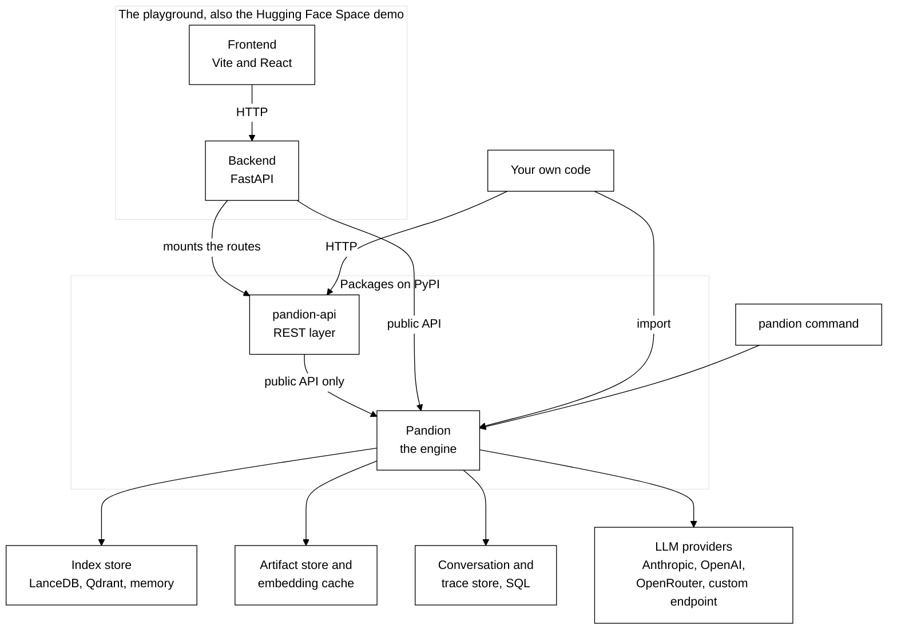
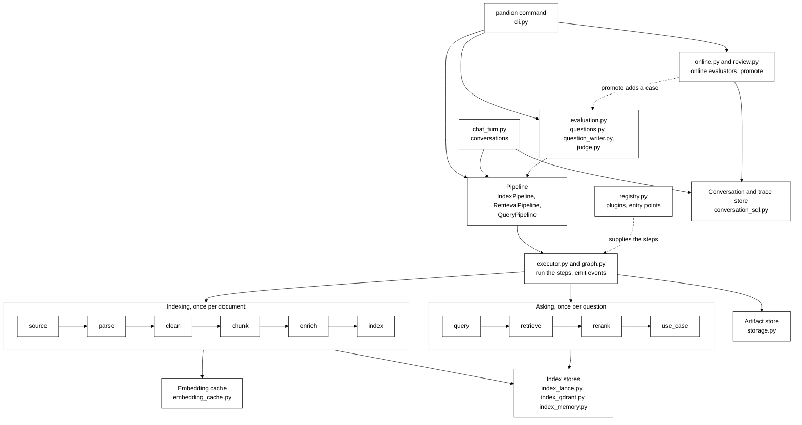
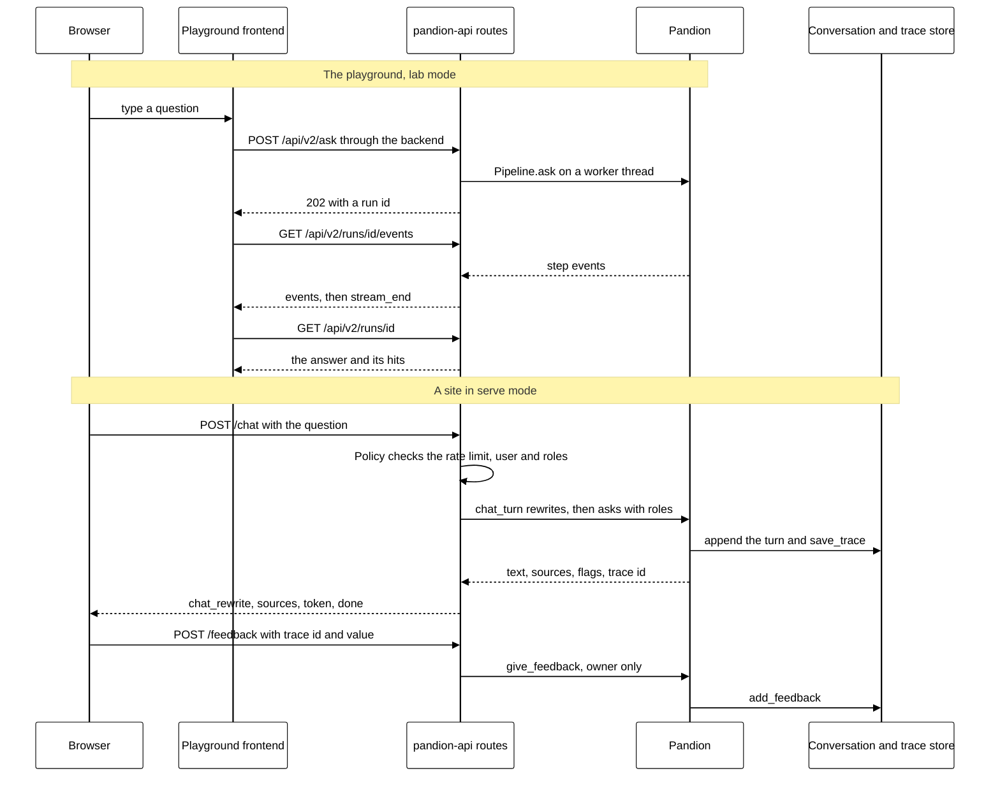
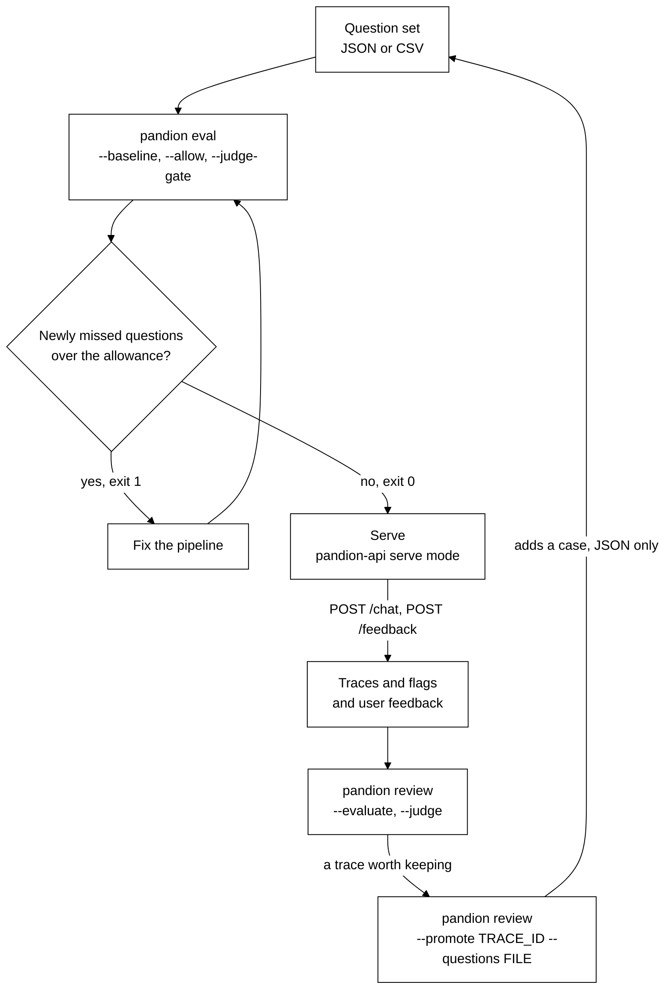

# Architecture

RAG Playground is three parts that sit on top of each other. **Pandion** is the engine: it runs
a retrieval pipeline from a config, with one plugin per strategy. **pandion-api** serves Pandion
over REST. **The playground** is a web app for learning RAG by experiment, and it is the demo on
Hugging Face. Each part uses only the public API of the parts below it. This page shows how they
fit together, with four diagrams, and says where to find each part's code.

## Contents

- [System overview](#system-overview)
- [What each layer owns](#what-each-layer-owns)
- [Boundary rules](#boundary-rules)
- [Inside Pandion](#inside-pandion)
- [Plugins and stores](#plugins-and-stores)
- [One question end to end](#one-question-end-to-end)
- [The quality loop](#the-quality-loop)
- [Sources and sync](#sources-and-sync)
- [Artifacts and the cache](#artifacts-and-the-cache)
- [The run stream](#the-run-stream)
- [Serve mode](#serve-mode)
- [How the web app talks to the API](#how-the-web-app-talks-to-the-api)
- [How the web app holds a pipeline](#how-the-web-app-holds-a-pipeline)
- [Where data lives](#where-data-lives)
- [Where to read more](#where-to-read-more)

## System overview

Your own code can use Pandion as a library, or call pandion-api over HTTP. The `pandion` command
runs Pandion directly. The playground backend serves pandion-api's routes under `/api/v2`, adds
its own teaching routes under `/api`, and serves the built frontend. The frontend never touches
Pandion; it only talks HTTP to the backend.

## What each layer owns

| Layer | What it owns | Code |
|---|---|---|
| Pandion | The pipeline and its stages, the plugin registry, the executor and its events, the artifact store and embedding cache, index stores, conversations, traces, evaluation, the `pandion` command | `packages/pandion/src/pandion/` |
| pandion-api | The REST routes, runs and their event stream, document storage, serve mode, and one `Policy` object for a site's rules | `packages/pandion-api/src/pandion_api/` |
| Playground backend | The playground's `Policy`, demo mode and its limits, the teaching routes (samples, learn, templates, settings), serving the web build | `playground/backend/` |
| Playground frontend | The pages (Home, Build, Compare, Evaluate, Library, Read), the working pipeline in the browser, the inspectors | `playground/frontend/src/` |
| Support | Bundled sample PDFs, the sample set and tools, tests | `samples/`, `scripts/`, `tests/`, each package's own `tests/` |

The backend has no pipeline steps of its own. Pandion loads its plugins itself, and the backend
only chooses where its files live (`playground/backend/deps.py`) and which models it loads.

## Boundary rules

- **pandion-api uses only Pandion's public API.** The public API is the names in `__all__` of
  `pandion`, `pandion.parse`, `clean`, `chunk`, `rewrite`, `retrieve`, `rerank`, `answer`,
  `pandion.extend` and `pandion.evaluation`. `packages/pandion-api/tests/test_api_boundary.py`
  fails on anything else.
- **The playground backend and its scripts use no private Pandion name.**
  `tests/integration/test_package_boundary.py` fails on any import of a module or name that starts
  with an underscore. It reads `playground/backend/`, `playground/frontend/scripts/` and `scripts/`.
- **Pandion never imports pandion-api or the playground.**
  `packages/pandion/tests/test_boundaries.py` checks this, and a search for such imports in
  `packages/pandion/src` finds none.
- **pandion-api never imports the playground.** A site's rules arrive as a `Policy` object, not as
  an import.
- **The frontend talks only to the backend, over HTTP.** It names pandion-api's routes under
  `/api/v2` and the teaching routes under `/api`. A test, `playground/frontend/src/api/oldRoutes.test.ts`,
  fails if a page names a route that no longer exists.
- **A request never names code.** A request's pipeline always runs with the server's folder and
  models, and it cannot name plugins to import (`pandion_api.pipelines.prepare`). A server loads
  its own strategies.

## Inside Pandion

The stage names are the `Stage` values in `pandion/ports.py`. `query_transform` is a stage with
no built-in strategy yet. `route` is not a stage: a pipeline file can sort documents into
categories with route checks (`pandion/routing.py`) before indexing. The `use_case` strategies
are in `plugins/answer/`.

| Stage | What it is for | Built-in strategies |
|---|---|---|
| `source` | The document you work on | `upload` |
| `parse` | Turns a file into text elements with pages and positions | `pdfium`, `docling` |
| `clean` | Removes text that would pollute retrieval | `header_footer_strip`, `dedupe_blocks`, `drop_matching` |
| `chunk` | Cuts the text into the pieces that get indexed | `recursive_character`, `markdown_header`, `token_based`, `layout_blocks`, `sentence_window` |
| `enrich` | Adds context to chunks before indexing | `llm_context` |
| `index` | Embeds the chunks and stores them for vector and keyword search | `lancedb`, `qdrant` |
| `query` | The question, optionally rewritten | `text`, `llm_rewrite` |
| `retrieve` | Finds the candidates | `dense`, `bm25`, `hybrid_rrf` |
| `rerank` | Picks the best few | `mmr`, `cross_encoder`, `llm_rerank` |
| `use_case` | What you finally get | `search`, `chat` (and `eval`, which scores a run and is not an answer step) |

A stage whose input and output have the same type can be stacked, for example two cleaners in a
row. [app/strategies.md](app/strategies.md) describes each strategy.

A pipeline is written one way everywhere: as a config, the shape of the pipeline file. It can be
a YAML file, a dict per stage, or step classes such as `pandion.parse.Docling`. Every way goes
through `pandion.config.from_dict`, so the same settings give the same graph and the same
artifact ids. The config is checked when it is read. A wrong step or setting is a `ConfigError`
with one sentence, which pandion-api returns as a 422. Under it, the engine has two ideas: an
**artifact** is an immutable result (a parsed document, a chunk set, an index, a set of hits), and
a **transform** is a strategy that turns typed input artifacts into one output artifact.

## Plugins and stores

A strategy is one Python module under `packages/pandion/src/pandion/plugins/<stage>/`. It defines
a Pydantic config model and a `Transform` subclass registered with `@register`. The class says
its stage, its input ports, its output type, a one-line `summary`, and an `explain(config)` that
says what the settings will do.

- `PLUGIN_MODULES` in `pandion/plugins/__init__.py` lists every built-in plugin module. A test
  fails if a module exists but is not listed.
- `pandion.plugins.load` is the one loader for built-ins, entry points (the group
  `pandion.strategies`) and listed modules. A failure stops the process. See
  [Loading your strategies](pandion/extend.md#loading-your-strategies).
- `GET /api/v2/strategies` exports every strategy with its summary, its config's JSON schema and
  what it requires and prefers. The web app builds every settings form from that schema, so a new
  strategy needs no frontend change.
- **Requires** is a hard lock: a retriever that needs a keyword index cannot run on an index built
  without one, and the pipeline is refused with a sentence that names both steps. **Prefers** is a
  soft lock: the strategy still runs but falls back, and says what happens instead.
- A strategy outside Pandion is registered the same way, with `@register` from `pandion.extend`.
  [CONTRIBUTING.md](../CONTRIBUTING.md#adding-a-strategy) walks through adding one to Pandion,
  and [examples/pandion/own_strategies/](../examples/pandion/own_strategies) writes one for every
  stage.

Three kinds of store sit beside the pipeline. Each is a Stable contract, and none is a pipeline step.
Index stores and conversation stores have a conformance test in `pandion.testing`
(`trace_store_conformance` covers traces).

- **Index stores** (`index_store.py`): `index_memory.py` is the reference, `index_lance.py` backs
  the `lancedb` step, and `index_qdrant.py` backs the `qdrant` step. See
  [Index stores](pandion/stores-and-access.md#index-stores).
- **Conversation stores** (`conversation_store.py`): `conversation_sql.py` is the `sql` store, on
  SQLAlchemy. A store can also be a `TraceStore`, and then `chat_turn` saves one `TraceRecord`
  (`trace_record.py`) for each answered turn. Chats, memories, traces and feedback live there, so
  servers keep no state. See [Conversations](pandion/conversations.md#conversations).
- **Sources** (`document_sources.py`): a place that lists documents, so `index.sync` can keep an
  index in step with it.

`pandion.chat_turn` runs one turn on top of a conversation store. History gives meaning, sources
give facts: a follow-up is rewritten into a standalone question, and the answer step is asked only
that question, so a stored answer never reaches it as a fact. With memory on (off by default), the
user's memories join the rewrite prompt only.

## One question end to end

The playground and a site in serve mode answer a question through different routes, so the
diagram shows both. The playground asks with `POST /api/v2/ask` and does not keep a trace. A site
built on pandion-api's serve mode asks with `POST /chat`, which keeps a conversation, saves a
trace and takes feedback.

In both paths the pipeline runs through the executor, and every step is a cache hit when its
recipe has run before. The playground runs the same engine as the site, so what you learn on the
playground carries over.

## The quality loop

1. **Evaluate offline.** `pandion eval CONFIG QUESTIONS` asks every question and scores it.
   `--record-baseline PATH` saves a run, and `--baseline PATH` compares
   a later run with it. The gate counts newly missed questions per `category:<name>` tag, so one category's loss is never hidden by another's gain, and exits 1
   when a category is over `--allow`. `--judge` grades each answer with a model, and `--judge-gate`
   fails the comparison when mean correctness falls by more than 0.05. See
   [Evaluate a pipeline](pandion/evaluate.md#evaluate-a-pipeline) and
   [Compare with a baseline](pandion/evaluate.md#compare-with-a-baseline). `pandion questions` can write a
   first question set from a document.
2. **Serve.** In serve mode each answered turn saves a trace. The server marks a turn that may
   have gone wrong with a flag (`low_grounding`, `declined`, `not_in_documents`) at no extra
   cost, and a user can say a trace was good or bad with `POST /feedback`. See
   [Flags and feedback](pandion/traces.md#flags-and-feedback).
3. **Review.** `pandion review` lists the traces that need a look. `pandion review --evaluate`
   scores the stored traces with your online evaluators (functions marked `@online_evaluator`),
   and `--judge` adds the built-in relevance judge, which calls a model. The server never runs
   evaluators. `pandion trace` and `pandion report` show one trace or a summary. See
   [Online evaluation](pandion/traces.md#online-evaluation).
4. **Promote.** `pandion review --promote TRACE_ID --questions FILE` adds a trace to the question
   set as a case. Given the pipeline file, it also says whether the miss is in retrieval or in the
   answer. See [Promote a trace to a test](pandion/traces.md#promote-a-trace-to-a-test).
5. **Evaluate again.** The new case is now part of the gate.

## Sources and sync

`index.sync` keeps an index in step with a place that holds documents: a folder, or a `Source`
with `name`, `list()` and `read(doc_id)`. `list()` gives an id, a version and labels for each
document, and no bytes. A pipeline file can name its source in a top-level `source:` block, and
`pandion sync` runs it and prints one JSON summary line (exit 0, 1 for a document left out, 2 for
refused).

- The manifest (`manifest.json` under the pipeline's `path`, see `pandion/manifest.py`) records each
  document's content hash, version, pieces, category and roles. A sync reads only the documents
  whose version changed, runs the index steps again from cached steps, reports what was added,
  changed, removed and unchanged, and deletes the previous index binding (its collection stays, see below).
- A source that lists nothing is refused, so the index and the manifest stay as they were.
- One sync runs at a time (`sync.lock`, `pandion/synclock.py`); a second raises `SyncBusy`.
- A document that cannot be indexed is set aside, listed in `SyncReport.failed` and tried again
  next sync. The rest are indexed.
- When the pipeline file has an `access:` block, each sync works out the roles of every document
  (`pandion/access.py`) and the index step writes them on each row. A search filters on the
  caller's roles inside the store, before ranking.
- The index step writes into a new collection named from the recipe hash. The previous collection
  stays, so a server on the old image still works, and older ones are dropped after seven days.
  `index_status()` is the server's check that its collection exists and matches its recipe.

The app does not use sync. Details: [Keep an index up to date](pandion/index-and-search.md#keep-an-index-up-to-date).

## Artifacts and the cache

An artifact's id is a hash of its recipe: the transform, its version, its fingerprint (such as the
model it used), its config and the ids of its inputs, keyed by input port. The id is known before
the transform runs, so a node whose artifact is already in the store is not run again. That is what
makes changing one setting cheap: sweeping three chunkers over one parse is one cached parse and
three new chunk sets.

- **The store** (`pandion/storage.py`) keeps each artifact in its own folder. A write goes to a
  temp folder and is moved into place, and `meta.json` is written last, so a crash never leaves
  an entry that looks finished. Nothing expires an entry; `DELETE /api/v2/cache` clears the store.
- **The embedding cache** (`pandion/embedding_cache.py`) keeps embeddings in SQLite, keyed by
  model, revision, dtype, kind and text, so the same piece is embedded once.
- **Uploads** are stored once, named by a fingerprint of their bytes (`pandion/sources.py`).
- An INDEX artifact is a small JSON binding, not the rows. It names the index store, its settings
  (never a secret), the collection and the recipe hash. Deleting it deletes only the binding.
- A transform with `cacheable = False` (`llm_rewrite`, `llm_rerank`, `chat`) runs every time. A node
  that reads from one hashes that input as its id plus a hash of the files it wrote, so a new
  output gives new ids from there on and the same output is a cache hit.

See [The cache](pandion/index-and-search.md#the-cache).

## The run stream

The executor (`pandion/executor.py`) walks a validated graph, skips any node whose artifact is
cached, and emits an event for each step. A failure is data, not an exception: a failed node is
recorded, the nodes below it are skipped, and unrelated branches keep running.

A run is two requests. `POST /api/v2/runs` (a card's Run on Build) or `POST /api/v2/ask` takes
the pipeline as a config, checks it, resolves the API keys from the request headers, starts the
run in a worker thread and answers 202 with the run id. `GET /api/v2/runs/{run_id}/events`
then streams the run's events as server-sent events: `run_started`, `node_started`,
`node_finished`, `node_skipped`, `node_failed`, `run_cancelled` (when stopped), `run_finished`,
then `stream_end`. A cancelled run sends `run_cancelled` and then `run_finished`. A client
that reconnects passes the last event id. `POST /api/v2/runs/{run_id}/cancel` stops a run, and
`GET /api/v2/runs/{run_id}` holds its result.

The run manager is `pandion_api.runs.RunManager`, one per app, so the demo's limit on runs at
once holds across runs, questions, evaluations and comparisons. Keys live only in the run's
worker for its duration, and every event passes through a filter that replaces a key with
`[redacted]` (`pandion_api.credentials.redact`). On the demo a run is its visitor's own.

Compare uses `POST /api/v2/comparisons`: one stage, up to ten variants, each the block the
pipeline file takes for that stage. Evaluate uses `POST /api/v2/evaluations`.

## Serve mode

`create_app(mode="serve")` is the second way to run pandion-api. It loads one pipeline file at
startup and answers `POST /chat` (and `POST /ask`, `/feedback`, `/conversations`, `/health`,
`/ready`) for a site's users. The site's `Policy` decides who they are (`user_id`), what they may
find (`roles`) and how often they may ask (`limit`). The route reuses the run manager, so a turn
is a run on a worker thread, and the client's disconnect cancels it.

Serve starts hardened: it will not start without a Policy that overrides all three methods
(`Policy.anonymous()` says so on purpose), a caller sees a generic error with a trace id, keys
come from the environment only, and each user has a rate limit and an active-turn cap. A middleware
gives each request a trace id (`X-Trace-Id`) and the app logs one JSON line per request and per
step. When `OTEL_EXPORTER_OTLP_ENDPOINT` is set, a turn becomes one OpenTelemetry span tree, and
Prometheus counters are served when `ServeSettings.metrics_port` is set. See
[Serve mode](pandion-api/serve-mode.md#serve-mode), [hardened defaults](pandion-api/serve-mode.md#serve-mode-hardened-defaults),
[Logs and traces](pandion-api/serve-mode.md#logs-and-traces) and [Metrics](pandion-api/serve-mode.md#metrics).

## How the web app talks to the API

The web app is React, built with Vite into `playground/frontend/dist`. FastAPI serves it, with a
fallback so every client route opens the app. The app uses relative paths, so the same code works
in development, where Vite on port 5173 proxies `/api` to the server on port 8000.

The server answers on two prefixes (`playground/backend/main.py`). `/api/v2` holds pandion-api's
routes with the playground's `Policy`: every run, question, evaluation, comparison, document,
result and key check goes through them. `/api` holds only the playground's teaching routes,
each in `playground/backend/routes/`: health, strategies and stages, sources and samples, learn,
settings, questions, templates and project. `tests/api/test_routes.py` pins the list and checks
that every path the web's two clients (`playground/frontend/src/api/client.ts` and `v2.ts`) name
is served.

- **Strategies.** The app reads `GET /api/v2/strategies` to build the step cards and their forms,
  and `POST /api/v2/explain` for each card's sentence. Prompts are settings marked `readOnly`;
  the form leaves them out and the playground's Policy refuses a changed one (`served_catalog` in
  `playground/backend/routes/registry.py`).
- **Runs.** A card's Run sends the pipeline as a config with `through` set to the card's step.
  Ask sends the config, its documents and the question. Evaluate sends the whole question set in
  one request and shows the totals the server returns, so the browser adds up no score.
- **Results.** The inspectors read `GET /api/v2/results/{id}/payload`.
- **Documents.** Uploads, page images and a document's question set come from
  `/api/v2/documents`. Loading a bundled sample is `POST /api/sources/sample`.
- **Demo mode.** `GET /api/settings/app` says whether demo mode is on and gives its limits. The
  playground's Policy refuses a custom model endpoint on the demo (403), and Pandion checks it
  again in `pandion.llm` when `public_endpoints_only` is on, so the check holds even if the first
  is lifted. API keys reach a run only as `context_extras["credentials"]`, never in a config or a
  hash.
- **State.** Saved pipelines, experiments and the working pipeline live in the browser's storage;
  see [privacy.md](privacy.md).

## How the web app holds a pipeline

The browser holds a pipeline as a Pandion config, the pipeline file's shape (`PipelineConfig` in
`playground/frontend/src/state/config.ts`), with the documents it runs on and the question Ask
asks beside it. It never holds `path`, `models` or `plugins`: the server sets the first two and
refuses the third.

- **The working pipeline** is the copy Build edits. It lives in localStorage under
  `rag-playground:pipeline:v2` (`state/working.ts`), and Compare and Evaluate read the same copy.
- **Saved pipelines** live under `rag-playground:pipelines:v2` (`state/pipelines.ts`), up to twenty.
  Save copies the working pipeline into the list. Opening a saved pipeline copies it back, and
  editing on Build never changes a saved pipeline until you save again.
- **Share links** (version 3) and **export files** (version 2) carry the same config with its
  documents and question. Opening a link saves it as a pipeline and puts it on Build.
- **Build draws a column from the config** with `columnOf`, and stores a column back as a config.
  A document's category is a pin on its reference, sent as `categories` on runs, asks, evaluations
  and comparisons.
- **Old keys are converted once.** Before part 5 the browser kept graphs under
  `rag-playground:graph:v1` and `rag-playground:pipelines:v1`. The first read that finds nothing
  under the new key converts the old one with `graphToConfig`, and never writes or removes an old
  key. What cannot be converted is kept with its reason, never dropped.
- **The guided run** on Build (`components/guide/`, `state/guide.ts`) walks Document, Parse, Clean,
  Chunk, Index, Ask and Fix with real runs (`GuideStage` in `state/guide.ts`), from a link such as `/build?guide=<stage>`.

The fixture `playground/frontend/src/api/fixtures/starter.config.json` is `samples/starter.yaml`
as the browser holds it, and two tests pin that converting the app's Starter gives that file.

## Where data lives

- The server keeps its files in one data folder with `sources/`, `artifacts/` and `embeddings/`.
  The playground sets the first two with `RAG_PLAYGROUND_SOURCES` and `RAG_PLAYGROUND_ARTIFACTS`
  (`playground/backend/deps.py`), and they must sit side by side.
- In serve mode the SQL conversation and trace store is the database in `PANDION_CONVERSATIONS_URL`.
  Without it, it is a SQLite file, `conversations.db`, in the data folder (`default_store` in
  `pandion_api/serve.py`).
- The lessons are switched off while they are reworked (`LESSONS_ENABLED` in
  `playground/frontend/src/state/lessons.ts`).
- `servedConfig` in `playground/frontend/src/state/config.ts` is where the browser drops prompts and
  settings the server does not know.
- `scripts/publish_space.py` deploys the Hugging Face Space.

## Where to read more

- [pandion/index.md](pandion/index.md): the engine's manual, from install to writing your own strategy.
- [pandion-api/index.md](pandion-api/index.md): every route, the `Policy`, serve mode and its defaults.
- [app/guide.md](app/guide.md): using the playground.
- [app/strategies.md](app/strategies.md): what each strategy does and when to pick it.
- [operations/deploy.md](operations/deploy.md): running the app, Docker and your own Hugging Face Space.
- [privacy.md](privacy.md): what is kept, where and for how long.
- [CONTRIBUTING.md](../CONTRIBUTING.md): setup, tests, adding a strategy or an endpoint.
