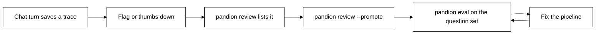

# Traces and online evaluation

Traces, flags and feedback, online evaluation and promoting a trace to a test.

[Manual index](index.md) | Previous: [conversations](conversations.md) | Next: [stores-and-access](stores-and-access.md)

## Traces

A trace is one record of what a chat turn did, kept so a person can read it later. It is **Provisional**. After an answered turn, `chat_turn` saves a `TraceRecord` when the store is also a `TraceStore`; a store without those methods keeps chatting and saves no trace. A failed or cancelled answer saves none, like the turn itself. A trace that cannot be saved is logged (the error type only, never its text, which may hold the question) and never fails the turn. `expire` also removes traces older than the limit, even when their conversation is gone.

A `TraceRecord` holds `trace_id`, `user_id`, `conversation_id`, `question` (as typed), `standalone`, `answer`, `label`, `source_ids`, `stages`, `cost`, `latency_ms`, `flags`, `scores`, `feedback` and `created_at`.

- `trace_id` is the id you pass to `chat_turn(..., trace_id=)`. When you pass none, `chat_turn` makes one (a uuid4 in hex) and puts it on the `Turn` too. The server passes the request's trace id.
- `label` is the worst grounding label in the answer, from worst to best `none`, `weak`, `similarity`, `cited`. An answer that only declined has `not_found`; one with no grounding counts (a `search` answer) has an empty label.
- `stages` lists each stage once, in order (a pipeline with several rerankers lists them as `rerank.1`, `rerank.2`), as `{"name", "ms", "dollars"}`. `dollars` is the estimated price of that stage, or `None` when it called no priced model. `cost` is the total, as `Answer.cost()` gives it, and `latency_ms` is the whole turn.
- `flags` is filled by `chat_turn` (see "Flags and feedback" below); `scores` is empty for now, evaluator scores fill it in later.
- `feedback` is a list of `Feedback(value="up" or "down", category, comment, created_at)`; `category` is at most 40 characters and `comment` at most 500.
- A record never holds a credential or an API key.

`TraceStore` is a runtime-checkable protocol with five methods. The `sql` store implements it in two more tables, `traces` and `feedback`, with a `traces` format row beside the `conversations` one in `pandion_schema`.

| Method | What it does |
| --- | --- |
| `save_trace(record)` | Keeps the record, stamping `created_at` when empty. Saving an id again replaces the record and its feedback; an id that belongs to another user is refused with `ValueError` |
| `trace(trace_id, user_id=None)` | The record with its feedback. With a `user_id`, another user's trace is `None`; without one it is any trace, for the operator's tools |
| `traces(*, since=None, flagged_only=False, limit=100)` | Newest first. `since` is a UTC ISO time; `flagged_only` keeps records that have a flag |
| `add_feedback(trace_id, user_id, feedback)` | Adds feedback, replacing the same user's earlier feedback on that trace. Returns `False` when the trace is missing or is not this user's |
| `save_scores(trace_id, scores)` | Adds scores to the trace's own |

A trace holds the user's question, the answer and the passages it cited, so it follows the conversation. `delete_user`, `delete` and `expire` remove the traces and the feedback of the conversations they remove (and `delete_user` all of that user's), inside the same transaction. A store that implements `TraceStore` must do the same. Prove it with `trace_store_conformance`, from `pandion.testing`, which also checks that one user never reads or gives feedback on another user's trace.

```python
from pandion.testing import trace_store_conformance

trace_store_conformance(lambda: MyStore(MySettings()))
```

### Flags and feedback

Both are **Provisional** and live in `pandion.flags`, exported from `pandion.extend`.

`chat_turn` marks a turn that a person should look at. It reads facts the answer already holds, so a flag costs no model call. `TurnResult.flags` and the trace's `flags` list them, in this order:

| Flag | Means |
| --- | --- |
| `low_grounding` | some claim in the answer is labelled `weak` or `none` |
| `declined` | the model refused for safety (the answer's `stop_reason` is `refusal`) |
| `not_in_documents` | the answer says the documents do not cover the question, or the search found no piece at all (an empty index, or roles that hide every piece). Often correct; it points to a coverage gap |

A turn can carry more than one, and a well-cited answer carries none. `pandion report --flagged` and `traces(flagged_only=True)` keep only the turns that have a flag. A failed or cancelled answer has no flags, because it has no trace. `flags_for(answer)` gives the same list for an answer you hold.

`give_feedback(store, trace_id, user_id, value, *, category="", comment="")` records what a user thought of their own answer. `value` is `"up"` or `"down"`, `category` is at most 40 characters and `comment` at most 500. It returns `False` when the trace is missing or belongs to another user, so a user cannot tell a guessed id from a missing one. A user has one feedback per trace: a newer one replaces the older (`add_feedback` does this, and `trace_store_conformance` checks it). It raises `ValueError` with one sentence, which never repeats the category or the comment, when a value is out of bounds, and `TracesNotKept` (from `pandion.extend`, not a `ValueError`) when the store keeps no traces. The feedback appears in `pandion trace` and in the feedback counts of `pandion report`. A comment is user text: keep it out of logs and metric labels.

```python
from pandion.extend import give_feedback

result = chat_turn(p, store, user_id="alice", question="What is the notice period?")
give_feedback(store, result.trace_id, "alice", "down", category="wrong", comment="It is 60 days.")
```

### Read traces from the command line

`pandion trace` and `pandion report` only read traces from the store you point at (the store may create its tables on first open). They print no more than the record or the summary shows. A trace holds the user's question, the answer and the passages it cited, so treat the output as you would the conversation.

```
pandion trace TRACE_ID [--store sql] --url-env VAR [--json]
pandion report [--since 7d] [--flagged] [--store sql] --url-env VAR [--json]
```

`--url-env` names the environment variable that holds the database url; the sql store needs it, so the command never opens a new, empty database by mistake. `pandion trace` prints the question, the question it searched with, the answer, the label, the flags, the time and cost, a row for each stage and any feedback. It exits 1 with one sentence when there is no such trace, or when the store does not keep traces.

```
$ pandion trace 9f2c --url-env PANDION_CONVERSATIONS_URL
Trace 9f2c (2026-11-02T09:14:03+00:00), user alice, conversation c1
Question: What is chunking?
Answer: Cutting text into pieces.
Label: cited. Sources: s1.
Flags: none.
Took 812 ms and cost $0.0012.
Stages:
  retrieve       12 ms       none
  answer        800 ms    $0.0012
```

`pandion report` summarises the stored traces (the newest 10,000): the number of turns, the median and 95th percentile time (linear interpolation between ranks), the cost in all and per turn, how many turns had each label, each flag and each feedback value, and the mean of every numeric evaluator score. Boolean and text scores are counted as `name: value`. When the store holds more than 10,000 traces, the report covers the newest 10,000, says so on stderr, and sets `capped` in `--json`; narrow it with `--since`. `--flagged` keeps only turns with a flag. `--since` takes a duration (`24h` or `7d`) or an ISO 8601 date such as `2026-10-01` (UTC when it has no zone); anything else is refused with exit 2. With no traces it prints `0 turns.`

```
$ pandion report --since 7d --url-env PANDION_CONVERSATIONS_URL
2 turns. Median 450 ms, 95th percentile 495 ms.
Cost $0.0030 in all, $0.0015 a turn.
Labels:
  cited  2
```

`--json` prints the `Report` (or the `TraceRecord`) as JSON. The same functions are public in `pandion.extend` as `summarise_traces`, `parse_since`, `format_trace`, `format_trace_report` and `TraceReport`, **Provisional**.

## Online evaluation

An online evaluator checks the chats you already stored. It is a function of one `TraceRecord`, registered with `@online_evaluator`, and it runs only when you run `pandion review --evaluate` (from your own scheduler, such as cron). Pandion runs no job of its own, and no server runs an evaluator.

```python
from pandion.extend import TraceRecord, online_evaluator

@online_evaluator("answer_length", version="1", outputs={"words": "float", "one_word": "bool"})
def answer_length(trace: TraceRecord) -> dict[str, float | bool]:
    words = len(trace.answer.split())
    return {"words": float(words), "one_word": words == 1}
```

- `outputs` names every value the function returns and its type: `"float"`, `"str"` or `"bool"`. The function must return exactly those keys with those types, or the run counts as a failure.
- The evaluator sees only the stored trace (question, standalone question, answer, label, source ids, flags, feedback). It gets a copy, and it never searches again.
- Scores are saved on the trace as `<name>@<version>.<output>`, for example `answer_length@1.words`. A new `version` scores every trace again beside the old scores. A trace that already holds every score of the current version is skipped, unless you pass `--rerun`.
- `pandion report` averages the `float` scores and counts the `bool` and `str` values. A `str` output should be a label from a small fixed set, never free text, because `pandion report` counts each distinct value. A `float` must be finite: NaN and infinity count as a failure.
- A name can be registered once; a second one is refused with a sentence. The evaluator is listed by `pandion plugins` as `online evaluator`. It is **Provisional**. Load your module with `--plugins` or with `load_plugins`. The tested example is [`answer_length_evaluator.py`](../../examples/pandion/extensions/answer_length_evaluator.py).

```
pandion review [--since 7d] [--store sql] --url-env VAR
pandion review --evaluate [--only NAME ...] [--sample 1.0] [--rerun] [--judge [--judge-model ID]] [--since 7d] [--store sql] --url-env VAR --plugins my_evaluators
```

- Without `--evaluate`, `pandion review` lists the traces that have a flag or a thumbs-down, newest first, one line each. Read one with `pandion trace`.
- With `--evaluate`, `--only` picks evaluators by name (all by default), and `--sample` is the share of traces to score, such as `0.02` or `2%`. The sample is a fixed hash of the trace id and the evaluator name, so every run checks the same traces. It reads at most the newest 10,000 traces; narrow with `--since`.
- An evaluator that raises never stops the review or the other evaluators. Standard error says how many runs failed and with which exception type, for example `answer_length@1: 3 failed (KeyError: 3)`. The message and the trace text are never printed or stored. A failed run saves nothing, so the next review tries it again. Pandion sets no per-evaluator timeout; an evaluator that calls a network sets its own.
- It exits 0 after a review, even when some runs failed, and 1 for an unknown evaluator name, a bad `--sample`, a store without traces, or no evaluator registered.
- Only the stored numbers leave the evaluator. No metric carries text.

### The relevance judge

A trace keeps the passages its answer cited (`sources`: an id and the text, each cut to 2,000 characters; traces saved before this have none). `pandion review --evaluate --judge [--judge-model ID]` adds the built-in `relevance` evaluator, which asks a model whether the answer addresses the question and stays within those passages, and saves a score from 0 to 1 as `relevance@1.score`.

- It runs only with `--judge`; `--only relevance` without `--judge` is refused, as is `--judge` without `--evaluate` or `--evaluate` together with `--promote`. It checks the model key once before the batch and exits 1 if it is missing. It is one model call per trace, so combine it with `--sample`; the summary ends with `Judge cost: about $...`.
- The judge reads the stored question, answer and passages in fenced blocks (any `<` is escaped, so text cannot close a fence), at temperature 0. It never searches again. Models that need a name or URL (OpenRouter, custom) are refused.
- A trace with no stored passages is counted as skipped. A reply that is not usable, or a failed call, is counted as a failure like any evaluator failure, and the trace is tried again next time.

### Promote a trace to a test

```
pandion review --promote TRACE_ID --questions questions.json [pipeline.yaml] --url-env VAR
```

adds the trace to a JSON question set as one case: its id is the trace id, its question is the standalone question (for a follow-up, the question as asked, with the earlier turns as `history`, so `pandion eval` replays the rewrite), the passages it cited are the expected `gold_answers`, each one a whole cited passage of up to 2,000 characters, so trim it to the sentence that answers (the command prints this hint). The file is created if it is not there; promoting the same trace twice adds it once. The case is a copy in your file, outside retention: `forget-user` and `expire` do not reach it. The file loads and runs with `pandion eval` like any other set.

With a pipeline file it also runs the new case once and says whether the miss is in retrieval (the search does not return the cited passage), in the answer step (it does), or that the cited passage is no longer in the document. It exits 1, with a sentence, for a trace that does not exist, a trace with no stored passages, or a questions file that is not JSON.

The review loop:



The functions are public in `pandion.extend`: `online_evaluator`, `OnlineEvaluator`, `relevance_evaluator`, `run_evaluators`, `ReviewResult`, `promote`, `Promoted`, `TraceSource`, `format_review_list`, `format_review_result` and `parse_sample`.
