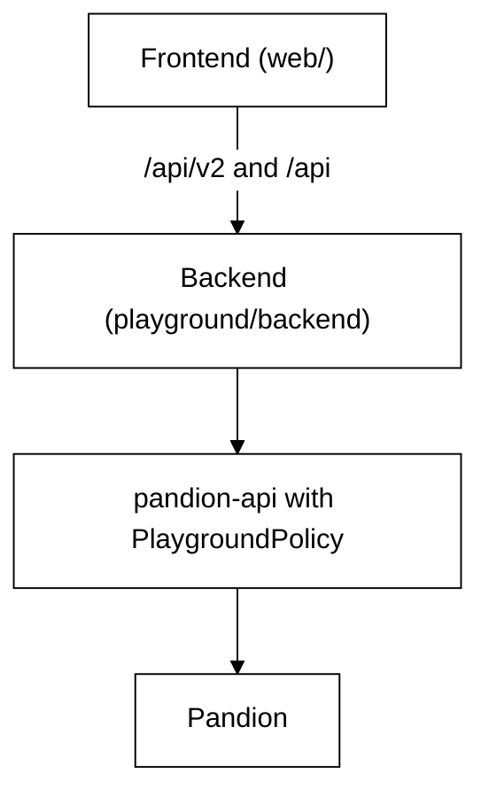

# The playground app

RAG Playground is a website where you build a RAG pipeline step by step and see what each
step does to a real document. The public copy runs on Hugging Face at
[huggingface.co/spaces/nadeem4nk/rag-playground](https://huggingface.co/spaces/nadeem4nk/rag-playground).
You can also run the same app on your own machine.

The app has two halves:

- **The frontend** is the React app you see in the browser. It is still in `web/` at the
  root of the repo for now, and it moves to `playground/frontend/` next.
- **The backend** is the Python server in [backend/](backend/README.md).

## How the two halves fit

The frontend talks to the backend only over HTTP. Almost everything it does goes through
`/api/v2`: documents, runs, questions, evaluations, comparisons and key checks. A few
playground-only routes sit beside them under `/api`, such as the sample list and the
lessons.

The backend is [pandion-api](../packages/pandion-api/README.md) with the playground's own
rules. It calls `pandion_api.create_app` with `PlaygroundPolicy`, which holds the rules
for the hosted demo, such as the upload limits and keeping each visitor's uploads private.
It then adds the playground-only routes and serves the built frontend as a static site.
pandion-api runs every pipeline with [Pandion](../docs/pandion.md), the engine.



## Run it locally

You need Python 3.13 with [uv](https://docs.astral.sh/uv/), and Node.js 22.

```bash
cd web && npm install && npm run build && cd ..
uv run rag-playground
```

The server starts on http://127.0.0.1:8000 and opens your browser. It serves the build in
`web/dist`. You can also start it with `uv run uvicorn playground.backend.main:app`.

To work on the frontend, keep the server running and start the Vite dev server with
`cd web && npm run dev`. It sends every `/api` request to the server on port 8000.

[docs/architecture.md](../docs/architecture.md) explains the whole design, and
[CONTRIBUTING.md](../CONTRIBUTING.md) covers the tests.
